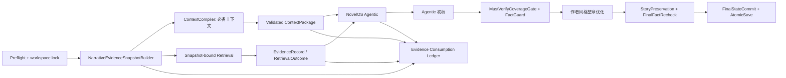

# PiNovelStudio 知识检索、证据选择与 ContextCompiler 质量治理开发计划

**任务编号**：`CONTEXT-EVIDENCE-GOVERNANCE-1`  
**版本**：v1.1  
**日期**：2026-08-15  
**状态**：Wave 0 已完成实现与专项复验；Wave 1–4 代码已接线。Wave 5：xinmo ch23 真实 Gemini 平铺/分层对照已跑，确定性门槛通过，分层未晋级（缺真人匿名结论）。Wave 6：20/50/100 fixture + xinmo/fuben 只读 snapshot 回放已完成，未删除生产旧路径。真实 gpt5.6-sol 评审已执行，但 `rel-prod-112/113` 均因正反序冲突保持 `held`；唯一 active_prod 仍为 `rel-prod-111`。`production_like` 因环境指纹不匹配 fail-closed，不能视为生产等价验收完成。  
**适用范围**：`novel_generate_chapter -> ContextCompiler -> NovelOS Agentic -> CoverageGate / FactGuard` 统一生产主链路

## 1. 计划结论

本板块不建设一套新的“更强 RAG”，而是把现有检索、长期状态、信任分槽、上下文预算和 Agentic 工具收敛为一套可证明的证据治理链路：

1. 每次生成只创建一份冻结的 `NarrativeEvidenceSnapshot`；ContextCompiler、Agentic 检索和事实门禁只能读取该快照。
2. 系统决定什么有资格成为候选证据、什么必须预装、权威等级、冲突处置、工具白名单和预算；模型只决定如何查询、是否继续查询和何时起草。
3. ContextCompiler 只预装 P0/P1 必备上下文和经预算准入的工作集；远章事实、历史原文、未选中伏笔、PatternMemory 与参考示例默认按需检索。
4. 证据选择采用“资格过滤 + 权威分层 + 冲突隔离 + 层内相关性排序”，不再用一个可被新近性或关键词分数冲掉权威的总分。
5. `ContextPackage` 成为生产模型静态输入的唯一结构化载体；Agentic 动态工具结果使用同一信任协议和证据记录，不再直接拼接未经验证的文本。
6. trace 必须能从快照、候选、选择、裁剪、渲染到每个模型回合的实际输入逐项回放，不能只记录“曾经检索到”。
7. 分层 Prompt 是否替换当前平铺 Prompt，必须经过隔离真实 A/B 和真人匿名判断；未证明正收益前不切生产。
8. 新链路晋级后物理删除旧读取、旧排序、旧签名和旧生产渲染路径，不保留长期双实现或回退开关。

最终设计原则：

> ContextCompiler 给模型稳定、可信且足够的起点；Agentic 检索给模型自主寻找缺失证据的空间；CoverageGate 和 FactGuard 保证这种自主性不越过事实边界。

## 1.1 2026-08-15 执行状态更新

本节记录开发回复对应的执行结果，作为后续排期和发布判断的当前状态。

| 项目 | 当前结果 | 计划含义 |
|---|---|---|
| Wave 0 契约/测试 | 正式契约测试 `10/10` 通过；RED 探针预期 `4/4` 失败；`build:test` 已通过 | Wave 0 可以收口，保留 RED 作为 Wave 1 的转绿验收 |
| FailureClass 口径 | 已使用生产 `preflight / recoverable / interrupted / blocked / fatal`；不再冻结 `severity` 或废止的 `hard_block` | 后续实现只能消费 `failureClass`，兼容字段不得成为新契约 |
| G1 探针边界 | 只约束 `NarrativeSearchService.queryCanon()`；`importFromLegacy` 仍可作为只读 adapter | Wave 1 迁移目标是生产动态检索单一真相源，不要求立即删除 adapter |
| release gate 路径 | CLI 传入仓库根 `REPO_ROOT`；仓库根/扩展根 layout 共用 `resolveProductionEvolutionRoot()` | production snapshot 与 stale guard 必须继续共用解析函数 |
| `recorded` replay | PASS：`completed=1`、`isolation=0`、`traceRetentionRate=1`、P6 approved | 仅证明确定性回放闭环，不等于生产路由验收 |
| `synthetic` replay | PASS：同上 | 仅证明合成样本闭环，不等于生产路由验收 |
| `production_like` replay | 正确阻断：读到 `rel-prod-111` 后因 environment fingerprint mismatch 未启动模型，`traceRetentionRate=0`，P6 insufficient | 这是有效的生产安全门禁；在新 release capture/promote 前不得标记生产等价回放完成 |
| 真实 release 评审 | `rel-prod-112`、`rel-prod-113`：`forward=HOLD`、`reverse=APPROVE_DEV`、终裁 `HOLD`、状态 `held` | `canPromote=false`；held release 不得改回 evaluated、不得晋级 active_prod；同一基线不重复换号为 `rel-prod-114` |
| JSON 适配层修复 | HTTP 适配层及中文化后的消息均补入字面量 `json` | 已提交 `02dc97c`；该提交尚未进入已批准 active production release，不得当作生产等价证据 |

当前工作树证据仍绑定干净提交 `c4a2c0e`，但 HEAD 已是 `4a80960`（其上还有 `02dc97c`），且还有大量未提交源码。active_prod 仍为 `rel-prod-111`。该 release 的 recorded 指纹为 `a43509f0…`，而 `c4a2c0e` 干净树上的 production_like 回放指纹为 `7b48cb05…`；采集指纹 `9373e4fc…` 也与回放不一致。`rel-prod-112/113` 的 HOLD 还包含评审包身份泄漏：正文写入了 `rel-prod-111/112`，中文化后变成 `未戊丑-巳未辰丁-112`，正反序冲突。不得把未提交或未绑定最终 commit 的报告写成正式 release evidence。

### production_like 继续执行的前置条件

以下动作会修改生产指针，必须由发布负责人明确批准后执行：

1. 提交路径解析修复和已验证的 JSON 适配层修复，形成唯一可复现代码提交；
2. 固定 capture 与 replay 的完整环境集合（密钥/开关、模型路由、构建产物、配置和工作树状态），先做 fingerprint 一致性预检；
3. 在该提交和同一环境快照上重新 capture；
4. 如需重新评审，必须使用新的评审包明确说明“路径解析缺陷 vs 修复”，不得对同一基线仅换 release 编号重试；
5. 获得人工审批后再 promote 新的 active production release；
6. 在同一干净提交和同一环境上重跑 `recorded`、`synthetic`、`production_like`；
7. 重绑全部 evidence，核对 releaseId、codeCommit、environment fingerprint、tracePath 和 P6 结论。

未完成上述步骤前，开发状态应写为“生产等价回放被正确 fail-closed”，不得写为“生产验收通过”。

### HOLD 处置决策

当前建议接受 HOLD 作为本轮安全结论：确定性回放通过、真实评审链路可用、生产门禁有效，但没有获得可晋级证据。只有在发布负责人明确授权后，才可选择“换评审包 + 对齐环境 + 新 release”路径；不得自动发起人工审批，也不得通过重复换号消耗评审次数来绕过 HOLD。

## 2. 当前基线与已确认缺口

以下结论基于 2026-08-15 当前工作树的只读核查。现有机制应保留并迁移，不应重复实现。

| 范围 | 当前实现 | 判定 |
|---|---|---|
| ContextCompiler 状态读取 | `v2/core/context-compiler.ts` 直接读取正式 `NarrativeStateStore` | 保留正式状态语义，但改为消费冻结快照 |
| Agentic 动态检索 | `novelos/agent/narrative-search-service.ts` 通过 `LegacyStateAdapter` 重新组装状态，并直接读取历史章节文件 | P0 缺口：与 ContextCompiler 不同真相源 |
| 生产检索排序 | `v2/core/context-retrieval.ts` 使用权威、角色、关键词、章节距离、Promise 热度等加减分后统一排序 | P0 缺口：低权威高相关条目仍可能越级 |
| 二次裁剪 | `ContextRetrieval -> ContextSafety -> buildHistoricalContext(4/6/4) -> Agentic 工具独立排序` | P0 缺口：选择结果与最终输入可能不一致 |
| 未来/过期状态 | 已在评分前排除未来状态、不可解析章节与 TTL 到期记忆，并写入报告 | 保留并提升为统一资格闸门 |
| 必需 Promise | 已有 `forcedRecallIds`，不会被普通 Top-K 挤掉 | 保留，但不得绕过资格、冲突和过期检查 |
| PatternMemory | 已有 advisory 专用配额和权威降级 | 保留 advisory 身份；默认是否预装由 A/B 决定 |
| 工具结果协议 | 已有 `sourceRef`、`evidenceLevel`、`resultKind=no_match`、`truncated`、`nextQueryHint` 和 TrustedToolResult 消费闸门 | 复用；补齐 query 级 `retrieval_error` 与统一 EvidenceRecord |
| 信任分槽 | `context-safety.ts` 已实现 trust metadata 和 `compileConstraintManifestToContextPackage()` | 资产已存在，但生产主入口尚未把 ContextPackage 作为唯一模型输入 |
| 上下文 hash | ContextCompiler 有内容 hash；`legacy-trace-adapter.ts` 仍用 facts/openLoops/characters 等数量生成轻量签名 | P0 缺口：内容变化但数量不变时 hash 不变 |
| Prompt 渲染 | `gemini_writer_v2` 为生产平铺契约；`gemini_writer_v2_layered` 为 eval-only | 保持隔离，真实 A/B 后做单版本决策 |
| 事实验证 | MustVerifyCoverageGate、Agentic FactGuard、知识边界、StoryPreservation、FinalFactRecheck 已存在 | 全部保留，不以检索成功替代生成后验证 |

### 2.1 必须避免的重复建设

- 不新建第二套 NarrativeStateStore、MemoryRecord、trustClass、ContextPackage 或 AuditEvent 协议。
- 不把 eval-only `memory-retrieval.ts` 晋级为第二个生产排序器；生产最终只保留一个排序权威。
- 不把九个专用工具强制收敛成单一 facade。既有真实 replay 已表明 facade 尚未满足生产晋级条件。
- 不因本计划重启已收口的“上下文压缩收益”研究。当前生产 A 基线继续有效；任何压缩变更必须单独证明事实安全不下降。
- 不引入机器文学裁判，不以单一质量总分决定正文或 ContextCompiler 方案。

## 3. 目标架构



### 3.1 四层上下文

| 层 | 内容 | 进入方式 | 权威 |
|---|---|---|---|
| L1 权威快照 | 作者声明、最终正文索引、已提交状态、作品宪法、版本与 hash | 生成开始时冻结 | 系统维护，运行中只读 |
| L2 必备上下文 | 本章功能、不可违背事实、前章悬置、相关角色、选中 Promise/Expectation、世界硬规则、知识边界 | ContextCompiler 预装 | P0/P1 不可静默删除 |
| L3 按需证据 | 远章事件、历史正文 span、远距人物状态、未选中伏笔、旁支设定、PatternMemory、参考示例 | Agentic 工具查询 | 必须回源并带信任等级 |
| L4 生成后验证 | mustVerify 覆盖、事实/实体/时间线、角色知识边界、故事保持、最终事实 | 确定性门禁与验证器 | 事实失败 fail-closed |

### 3.2 决策权边界

| 决策 | 最终权威 |
|---|---|
| 数据是否有资格进入候选证据集 | 系统资格闸门 |
| 未来、过期、不可回源或冲突数据是否排除 | 系统资格闸门 |
| 证据权威等级与是否可作为硬事实 | 系统信任协议 |
| `mustVerify` 内容 | 系统 EvidencePlan |
| 必须预装的 P0/P1 内容 | ContextCompiler |
| 可见工具、最大调用数、超时和 token 预算 | 系统 Runtime |
| 查询词、工具顺序和查询细化 | Agentic 模型 |
| 是否零检索直接起草 | Agentic 模型；仍受 coverage gate 约束 |
| mustVerify 是否被有效证据覆盖 | MustVerifyCoverageGate |
| 硬事实冲突是否允许继续 | 系统 fail-closed |
| 正文事实是否正确 | FactGuard / FinalFactRecheck |
| 文学表现是否优秀 | 用户 |

## 4. 核心契约

Phase 0 必须先冻结以下契约。命名可在实现评审时微调，但不得产生平行 schema。

### 4.1 NarrativeEvidenceSnapshot

```ts
interface NarrativeEvidenceSnapshot {
  schemaVersion: number;
  snapshotId: string;
  workspaceId: string;
  workspaceRevision: string;
  lastCommittedChapter: string | null;
  releaseId: string;
  createdAt: string;
  knowledgeSnapshotHash: string;
  creativeConstitution: CreativeConstitution | null;
  narrativeState: Readonly<NarrativeStateStore>;
  acceptedChapterIndex: readonly AcceptedChapterEvidenceRef[];
  sourceHashes: Readonly<Record<string, string>>;
}
```

要求：

- 生成快照前完成必要的历史 backfill/migration；冻结后所有读取路径不得再写状态。
- `acceptedChapterIndex` 必须指向内容寻址的只读正文证据，或在读取时校验冻结 hash；不能在同一运行中直接读取被改写后的 live 文件。
- `knowledgeSnapshotHash` 由规范化内容计算，不使用数量、mtime 或路径摘要替代。
- 同一 run 的 ContextCompiler、检索工具、CoverageGate、FactGuard 和 trace 必须携带同一 `snapshotId`。
- workspace 在运行中被修改时，当前 run 继续使用冻结证据；无法取得冻结内容时结构化阻断，不切换到新状态。

### 4.2 EvidenceRecord

```ts
interface EvidenceRecord {
  evidenceId: string;
  statement: string;
  authorityClass: AuthorityClass;
  epistemicStatus: "confirmed" | "derived" | "advisory" | "conflicted";
  sourceRef: string;
  sourceContentHash: string;
  validFrom: string | null;
  validUntil: string | null;
  matchedBecause: string[];
  retrievalQueryId: string | null;
  snapshotId: string;
  traceable: boolean;
}
```

约束：

- 复用并收敛现有 `MemoryRecord.authorityClass`、trustClass/authority 与 `EvidenceLevel`，不得再创建互不映射的权威枚举。
- `confirmed/derived/advisory/conflicted` 描述证据本身；查询结果使用独立 `RetrievalOutcome.status`，避免把“没有结果”和“证据认识状态”混为一个枚举。
- 语义相似只允许召回候选；硬事实必须回源到作者声明、正式状态或最终正文 span。
- 无 `sourceRef`、hash 不匹配或无法回源的结果不得升级为 `confirmed`。

### 4.3 RetrievalOutcome

```ts
interface RetrievalOutcome {
  queryId: string;
  status: "match" | "no_match" | "retrieval_error" | "truncated";
  evidence: EvidenceRecord[];
  nextQueryHint: string | null;
  budget: { usedCalls: number; remainingCalls: number };
}
```

语义必须严格区分：

- `no_match`：检索成功且确认无合格结果。
- `retrieval_error`：读取、解析、hash 校验或工具执行失败；不得伪装成无证据。
- `truncated`：存在更多结果，模型可在预算内缩小查询。
- `match`：至少一条合格证据；不代表已满足 mustVerify，也不代表均可作硬事实。

### 4.4 EvidenceSelectionDecision

证据选择分为不可交换的阶段：

```text
Eligibility
  -> Authority partition
  -> Conflict isolation
  -> Required evidence reservation
  -> Match quality within authority tier
  -> Temporal validity / recency
  -> Diversity
  -> Token utility
```

规则：

1. 未来状态、到期记忆、非法来源、不可解析章节、无权进入当前用途的数据在评分前排除。
2. 作者正式声明、最终正文直接证据、已提交正式状态、可回源结构化推导、advisory/参考材料分层处理。
3. 低权威证据不得仅凭角色匹配、新近性或关键词分数越过高权威证据。
4. 同一实体存在未解决硬冲突时，冲突组整体标记为 `conflicted`；若命中 mustVerify/P0/P1，结构化阻断。
5. forced Promise 只保留“免普通 Top-K 淘汰”能力，不得绕过资格、有效期、冲突或回源校验。
6. 相关性分数只在同一权威/冲突层内排序，不再承担真相裁决职责。

### 4.5 ContextDeliveryLedger

每条证据必须以追加事件记录完整传递过程：

```text
discovered
eligible | rejected
selected
rendered_preloaded | retrieved_on_demand
delivered_to_model
dropped
```

每个事件至少包含：

```text
evidenceId / snapshotId / queryId / modelTurnId
action / reason / sourceRef / contentHash
contextPackageHash / modelInputHash / tokenEstimate
```

“模型实际看到”定义为该证据对应的规范化内容已出现在已发送的模型输入中，并能由 `modelInputHash` 回放；不能通过模型自述或“曾被检索”推断。

### 4.6 Hash 口径

生产必须区分并贯穿三个内容 hash：

| Hash | 覆盖内容 | 用途 |
|---|---|---|
| `knowledgeSnapshotHash` | 冻结状态、宪法、正文索引和来源 hash | 证明所有消费者读取同一真相 |
| `contextPackageHash` | 经资格、优先级、预算和信任分槽后的静态模型上下文 | 回放 ContextCompiler 输出 |
| `modelInputHash` | 每个模型回合实际发送的 system/user/tool 输入 | 证明模型实际可见证据 |

旧的数量签名不得继续写入生产 trace。兼容读取如确有必要只能存在于只读 adapter，并明确标记 `legacy_non_content_hash`。

## 5. 实施阶段

### Phase 0：契约冻结、基线盘点与 RED 测试（P0）

**目标**：先固定真相源、证据身份、查询结果语义、hash 和可观测性，不在未定义契约时改生产排序。

**任务**：

- `CEG-0.1`：冻结第 4 节五类契约及现有类型映射表，明确哪些字段复用 `MemoryRecord`、ContextPackage、TrustedToolResult 和 AuditEvent。
- `CEG-0.2`：输出生产读取/排序/裁剪/渲染/验证调用点清单，标注 owner、输入、输出和当前 hash。
- `CEG-0.3`：建立 RED 测试，证明当前以下问题真实存在：静态/动态真相不一致、同数量内容变化 hash 不变、二次裁剪导致 trace 与 Prompt 不一致、live workspace 修改影响动态检索。
- `CEG-0.4`：冻结现有生产 A 基线的检索参数和真实 replay 样本；本计划不得顺手调整 maxItems、maxChars、工具数量或模型路由。
- `CEG-0.5`：定义 FailureEnvelope gate：`snapshot_build`、`snapshot_hash_mismatch`、`evidence_conflict`、`retrieval_error`、`retrieval_budget_exhausted`、`must_verify_coverage`、`context_package_validation`。

**重点文件**：

- `v2/core/types.ts`
- `v2/core/context-compiler.ts`
- `v2/core/context-retrieval.ts`
- `v2/core/context-safety.ts`
- `novelos/tools/tool-protocol.ts`
- `v2/core/audit/*`

**完成标准**：契约评审通过；RED 用例在旧实现上稳定失败；没有生产行为变更。

### Phase 1：冻结权威叙事快照与单一读取源（P0）

**目标**：ContextCompiler、动态工具与所有事实验证器在一个 run 中只读取同一快照。

**任务**：

- `CEG-1.1`：实现 `NarrativeEvidenceSnapshotBuilder`，在 Preflight 后、ContextCompiler 前创建快照。
- `CEG-1.2`：把 `backfillAcceptedChapterState` 等写时迁移移到冻结前的显式准备阶段；禁止 ContextCompiler 和检索查询在读取过程中写状态。
- `CEG-1.3`：ContextCompiler 改为接收 snapshot，不再自行 `loadStateStore()`。
- `CEG-1.4`：NarrativeSearchService 改为接收 snapshot 或只读 snapshot reader；删除生产路径中的 `LegacyStateAdapter` 导入。
- `CEG-1.5`：历史正文检索改为消费 `acceptedChapterIndex` 的冻结内容引用，并校验正文 hash。
- `CEG-1.6`：CoverageGate、FactGuard、知识边界检查和 FinalFactRecheck 传播并校验 `snapshotId`。
- `CEG-1.7`：并发修改、进程中断和快照内容丢失均产生结构化 FailureEnvelope；禁止静默重读新 workspace 状态。

**重点文件**：

- 新建 `v2/core/narrative-evidence-snapshot.ts`
- `v2/core/unified-entry.ts`
- `v2/core/context-compiler.ts`
- `novelos/agent/narrative-search-service.ts`
- `novelos/agent/agentic-raw-candidate-source.ts`
- `novelos/verification/*`

**完成标准**：同一 run 所有证据事件的 `snapshotId` 唯一；正式状态与 legacy 文件冲突时不再产生 A/B/C 三套答案；运行中修改 workspace 不改变本次结果。

### Phase 2：统一证据记录、资格闸门与分层排序（P0）

**目标**：相关性只负责“找得像不像”，权威与冲突负责“能不能当事实”。

**任务**：

- `CEG-2.1`：建立从 Canon/Character/Promise/Expectation/Pattern/历史正文 span 到 `EvidenceRecord` 的单向 adapter。
- `CEG-2.2`：把未来状态、章节解析、TTL、trust、认识状态、sourceRef/hash 校验合并为一个 `EvidenceEligibilityGate`。
- `CEG-2.3`：把 `scoreEntry` 总分排序改为权威分区后的层内排序；输出结构化 `matchedBecause`，不再只给不可解释总分。
- `CEG-2.4`：实现实体规范化：结构化 ID、角色规范名、别名、简称；代词只作为查询扩展，不直接确认实体事实。
- `CEG-2.5`：实现混合检索顺序：精确 ID/章节/Promise -> 实体规范化 -> 关键词/短语/正文 span -> 关系扩展 -> 可选语义兜底 -> 回源验证。
- `CEG-2.6`：语义召回默认不引入新的向量数据库。只有现有层无法满足明确场景且离线评测证明正收益时，才单独立项；无论实现方式，语义结果不得自动升级为事实。
- `CEG-2.7`：保留九个专用工具为生产默认；facade 继续隔离，除非通过既有独立晋级门槛。
- `CEG-2.8`：同实体硬冲突形成 `ConflictSet`；作者修订必须走显式 supersede/invalidate 流程，不用更高权重静默覆盖。

**重点文件**：

- `v2/core/context-retrieval.ts`
- `v2/core/memory/memory-record.ts`
- `novelos/agent/narrative-search-service.ts`
- `novelos/tools/narrative-tools.ts`
- `novelos/tools/tool-protocol.ts`
- `v2/core/trust/tool-result-consumer.ts`

**完成标准**：未来/过期/不可信内容进入合格集为 0；低权威条目越级为 0；同实体硬冲突静默通过为 0；每条结果均可说明为何匹配及为何可信。

### Phase 3：ContextCompiler 必备/按需分流与 ContextPackage 生产闭环（P0）

**目标**：生产模型静态输入只来自验证后的 ContextPackage；检索型信息不再被重复预装和重复裁剪。

**任务**：

- `CEG-3.1`：定义确定性预装策略：P0/P1 全量保护；P2 受预算编译；P3/P4 默认按需或 advisory，不得提升为硬事实。
- `CEG-3.2`：ContextCompiler 直接从 snapshot 生成 `ConstraintManifest -> ContextPackage`，并在进入 Agentic 前完成槽位、来源、冲突、过期和预算校验。
- `CEG-3.3`：Agentic GenerationPacket 改为消费 ContextPackage 的 renderer 输出，不再从 `CompiledContext` 自行拼接 openLoops/worldRules/bridgeContext。
- `CEG-3.4`：`buildHistoricalContext` 从第二个排序/截断器收敛为纯 renderer，或在 ContextPackage 接线后删除；它不得改变已选证据集合。
- `CEG-3.5`：所有动态工具结果通过 TrustedToolResult -> EvidenceRecord -> tool message renderer；reference 内容保持无指令权。
- `CEG-3.6`：P0/P1 超出模型预算时返回 `failureClass=blocked`，并提供具体溢出项与修复指引；禁止静默删除保护上下文。
- `CEG-3.7`：保留现有生产 A 基线的条目数量和字符预算，直到 Phase 6 形成新的真实 A/B 结论。

**重点文件**：

- `v2/core/context-safety.ts`
- `v2/core/trust/context-package.ts`
- `v2/core/context-compiler.ts`
- `v2/core/model-prompt-adapter.ts`
- `novelos/agent/agentic-raw-candidate-source.ts`
- `v2/core/unified-entry.ts`
- `v2/core/unified-orchestrator.ts`

**完成标准**：生产 Agentic 静态输入只有一个 ContextPackage 来源；reference 无法进入 authority 槽；选择后不存在无审计的二次截断；P0/P1 丢失率为 0。

### Phase 4：检索结果语义、实际输入血缘与内容 hash（P0）

**目标**：能回答每个模型回合“看到了什么、没看到什么、为什么”。

**任务**：

- `CEG-4.1`：落地 `RetrievalOutcome`，把 `no_match`、`retrieval_error`、`truncated` 和 `match` 贯穿工具、trajectory、FailureEnvelope 与 CoverageGate。
- `CEG-4.2`：落地 `ContextDeliveryLedger`，记录 selected/rendered/retrieved_on_demand/dropped/dropReason/delivered_to_model。
- `CEG-4.3`：为静态输入和每次 tool-result 后的模型回合计算 `modelInputHash`，并记录证据 ID 到输入 span 的映射。
- `CEG-4.4`：统一规范化序列化函数；完整计算 `knowledgeSnapshotHash` 和 `contextPackageHash`。
- `CEG-4.5`：删除 `deriveContextHashFromCompiled()` 的数量签名生产写入；只读 legacy adapter 必须显式标注非内容 hash。
- `CEG-4.6`：AuditEvent/quality trace/trajectory 统一引用同一组 hash 和 ledger，不得各自再派生另一套签名。
- `CEG-4.7`：trace 持久化失败沿用现有 fail-closed/结构化降级规则，不允许无 trace 的成功交付。

**重点文件**：

- `v2/adapters/legacy-trace-adapter.ts`
- `v2/core/audit/*`
- `novelos/trajectory/*`
- `novelos/tools/tool-protocol.ts`
- `v2/core/unified-entry.ts`
- `v2/core/unified-orchestrator.ts`

**完成标准**：内容变化但条目数不变时三个内容 hash 正确变化；最终输入可解释率 100%；trace 选择集合与模型输入集合差异全部有 dropReason。

### Phase 5：CoverageGate、冲突与预算耗尽的闭环（P0）

**目标**：检索自主性可以失败，但不能越过事实边界或伪装成功。

**任务**：

- `CEG-5.1`：CoverageGate 只接受 `confirmed` 且可回源、snapshot/hash 一致的证据覆盖硬 mustVerify；`derived/advisory/conflicted` 不计硬覆盖。
- `CEG-5.2`：mustVerify 无覆盖时维持结构化阻断/既有受限恢复，不能靠 Prompt 自述通过。
- `CEG-5.3`：检索预算耗尽时返回 `retrieval_budget_exhausted`，包含未覆盖项、最后查询、已用预算和建议用户动作。
- `CEG-5.4`：`retrieval_error` 命中硬 mustVerify 时 fail-closed；非关键 advisory 查询错误可继续，但必须写 trace。
- `CEG-5.5`：冲突证据命中硬事实时 `evidence_conflict` 阻断；只影响文学参考的 advisory 冲突不得触发正文机械改写。
- `CEG-5.6`：FactGuard、知识边界、StoryPreservation、FinalFactRecheck 继续执行；检索覆盖成功不豁免任何生成后检查。
- `CEG-5.7`：零 mustVerify 且 ContextPackage 已充分时，允许零检索成功生成，并记录 `retrievalCalls=0`。

**重点文件**：

- `novelos/agent/must-verify-coverage-gate.ts`
- `novelos/agent/evidence-plan.ts`
- `novelos/verification/*`
- `craft/failure-envelope.ts`
- `v2/core/unified-orchestrator.ts`

**完成标准**：mustVerify 硬覆盖率 100%；未覆盖成功交付为 0；预算耗尽和检索错误均有可诊断 FailureEnvelope；零检索合法路径继续可用。

### Phase 6：Prompt 分层和上下文负载真实 A/B（P1）

**目标**：验证分层渲染是否既提高事实辨识，又不把文学表达机械化。

**任务**：

- `CEG-6.1`：在同一 snapshot、同一 ContextPackage、同一模型版本、同一 seed 和同一输出预算下，对比平铺 `gemini_writer_v2` 与分层 renderer。
- `CEG-6.2`：先通过确定性门槛：P0/P1 完整、mustVerify coverage、sourceRef、未来/过期泄漏、冲突、hash 和失败率不得劣化。
- `CEG-6.3`：再做真人匿名 A/B，评价自然度、人物存在感、叙事沉浸、信息负担和机械服从感；机器文学 judge 不作生产晋级依据。
- `CEG-6.4`：统计无关上下文比例、输入 token、检索调用数、延迟和成本；不得以 token 下降抵消事实安全下降。
- `CEG-6.5`：若分层版无明确正收益，继续保留当前平铺生产版本并关闭候选；若明确正收益，直接替换生产 profile 并删除旧生产渲染路径，不保留切换开关。
- `CEG-6.6`：本阶段不复活已失败的 D_mi/D_pm_sl 压缩组合；任何新压缩假设另行评测。

**完成标准**：有可复现的真实 A/B 报告、人工结论和发布决策；只有一个生产 renderer/profile。

### Phase 7：长篇回放、发布收敛与旧路径物理删除（P0）

**目标**：证明单一链路在长篇、并发和故障场景成立，并删除迁移残留。

**任务**：

- `CEG-7.1`：建立 20/50/100 章确定性长篇 fixture，覆盖远章事实、角色状态、Promise、知识边界、显式 canon 修订与 PatternMemory。
- `CEG-7.2`：至少使用两个真实 workspace 做 `novel_generate_chapter` 完整链路 replay；保留每个样本的 snapshot、ledger、trace 和输入 hash。
- `CEG-7.3`：执行并发修改、hash 不匹配、检索超时、空结果、截断、预算耗尽、硬冲突和 trace 写入失败故障注入。
- `CEG-7.4`：删除生产 `LegacyStateAdapter` 检索读取、重复排序/截断、数量 hash、旧 Context 拼接和已被替换的 Prompt 生产路径。
- `CEG-7.5`：更新依赖边界测试，确保 `dist/` 只有最新快照、检索、ContextPackage 和 renderer 实现。
- `CEG-7.6`：更新架构真相源、project-memory、运行手册和发布证据；历史报告只读归档，不继续作为可执行回退。

**完成标准**：第 8 节全部门槛通过；生产依赖闭包中没有旧读取/排序/签名/渲染路径；单一最新版本发布审批完成。

## 6. 建议开发波次与分工

以下表格用于安排执行。`负责人` 留给排期时填写；复杂度是相对值，不等同于自然日。

| 波次 | 工作包 | 优先级 | 复杂度 | 建议角色 | 依赖 | 可并行 | 负责人 |
|---|---|---:|---:|---|---|---|---|
| Wave 0 | CEG-0.1~0.5 契约、盘点、RED、基线 | P0 | M | 架构/测试 | 无 | 契约与调用点盘点可并行 | 本会话 |
| Wave 1A | CEG-1.1~1.3 快照构建与 ContextCompiler | P0 | L | 状态/核心链路 | Wave 0 | 与 Wave 1B 部分并行 | 已接线 |
| Wave 1B | CEG-1.4~1.7 Snapshot-bound 检索与验证传播 | P0 | L | Agentic/检索 | CEG-1.1 契约 | 与 Wave 1A 部分并行 | 已接线 |
| Wave 2A | CEG-2.1~2.4 EvidenceRecord、资格、实体规范化 | P0 | L | 数据/检索 | Wave 1 | 与 Wave 2B、2C 并行 |  |
| Wave 2B | CEG-2.5~2.8 分层排序、混合检索、冲突 | P0 | L | 检索/事实治理 | CEG-2.1 | 与 Wave 2C 并行 |  |
| Wave 2C | CEG-4.1~4.4 Outcome、Ledger、内容 hash | P0 | L | 可观测性/审计 | Wave 0 + snapshot schema | 与 Wave 2A/2B 并行 |  |
| Wave 3A | CEG-3.1~3.4 ContextPackage 生产接线 | P0 | L | ContextCompiler/Prompt | Wave 1 + 2A | 与 Wave 3B 部分并行 |  |
| Wave 3B | CEG-3.5~3.7 动态工具信任消费与预算 | P0 | M | Agentic/安全 | Wave 2A | 与 Wave 3A 部分并行 |  |
| Wave 3C | CEG-4.5~4.7 trace/hash 单一化 | P0 | M | 审计/兼容层 | Wave 2C | 与 Wave 3A/3B 并行 |  |
| Wave 4 | CEG-5.1~5.7 Coverage/冲突/预算闭环 | P0 | L | Gate/验证 | Wave 3 | 用例与实现可拆分 |  |
| Wave 5 | CEG-6.1~6.6 真实 A/B 与人工验收 | P1 | L | Eval/质量研究 | Wave 4 | 数据采集与人工盲评可并行 |  |
| Wave 6 | CEG-7.1~7.6 长篇 replay、清理、发布 | P0 | XL | 集成/发布治理 | Wave 4；Prompt 决策依赖 Wave 5 | replay 场景可并行 |  |

### 6.1 关键路径

```text
Wave 0 契约与 RED
  -> Wave 1 冻结快照
  -> Wave 2 统一证据与排序
  -> Wave 3 ContextPackage 生产接线
  -> Wave 4 Coverage/Fact 闭环
  -> Wave 5 Prompt A/B 决策
  -> Wave 6 真实 replay + 旧路径删除 + 发布
```

### 6.2 合并边界

- 每个 Wave 必须先合并契约/测试，再合并生产实现。
- Wave 1~4 不允许通过 feature flag 长期保留新旧生产路径；短期隔离测试只能存在于 eval/test 构建。
- Wave 6 删除动作必须在真实 replay 与 clean checkout build 通过后执行；删除后再次执行完整验证。
- 工作树当前存在大量用户在途修改，执行者必须逐工作包限定文件范围，不得恢复、覆盖、暂存或删除无关改动。

## 7. 最小验收矩阵

| ID | 场景 | 预期 |
|---|---|---|
| T01 | 100 章后查询第 1~10 章关键硬事实 | 召回且回源到正确 final span |
| T02 | 必需 Promise 面临大量高分候选 | 不被普通 Top-K 挤掉 |
| T03 | forced Promise 已过期或冲突 | 不绕过资格闸门，结构化阻断/隔离 |
| T04 | 当前章或未来章状态混入 store | 进入模型输入为 0 |
| T05 | TTL 到期 working/diagnostic memory | 进入模型输入为 0 |
| T06 | advisory 与 confirmed 矛盾 | advisory 不得覆盖硬事实 |
| T07 | 同一实体存在两条未解决硬事实 | 命中硬用途时 fail-closed |
| T08 | 正式 store 与 legacy 文件不一致 | ContextCompiler/工具只返回正式 snapshot；legacy 不参与生产 |
| T09 | 角色别名、简称、规范名 | 召回同一实体并保留规范化依据 |
| T10 | 代词或近义表达查询 | 可扩展候选，但不能仅凭语义确认硬事实 |
| T11 | 检索成功但无结果 | `no_match` |
| T12 | 文件读取、解析或 hash 校验失败 | `retrieval_error`，不得伪装 no_match |
| T13 | limit+1 证明还有结果 | `truncated=true` 且给出细化提示 |
| T14 | 无 mustVerify、ContextPackage 充分 | 允许零检索成功 |
| T15 | mustVerify 未被 confirmed 证据覆盖 | 不能成功交付 |
| T16 | 检索预算耗尽 | `retrieval_budget_exhausted` FailureEnvelope |
| T17 | 内容变化但条目数不变 | snapshot/package/input hash 均按影响范围变化 |
| T18 | ContextCompiler 选中后 renderer 丢弃 | ledger 必须记录 dropReason；P0/P1 则阻断 |
| T19 | 运行中 workspace 被修改 | 当前 run 仍使用冻结内容；新 run 读取新版本 |
| T20 | 历史正文包含提示注入文本 | 保持 reference，无指令权 |
| T21 | 工具结果包含“修改 Canon”指令 | 不提升权限，不进入长期状态 |
| T22 | 分层/平铺 A/B | 事实指标不降，文学结论由真人匿名判断 |
| T23 | trace 重放 | 可重建每回合模型输入和证据来源 |
| T24 | clean checkout 生产构建 | dist 不包含旧检索源、数量 hash 或双 renderer |

## 8. 生产验收指标

| 指标 | 目标 |
|---|---:|
| mustVerify 硬事实召回与覆盖率 | 100% |
| 未来状态泄漏 | 0 |
| 过期记忆泄漏 | 0 |
| 错误权威选择 | 0 |
| 硬冲突静默通过 | 0 |
| advisory 被当作硬事实 | 0 |
| `sourceRef` 完整率 | 100% |
| 冻结 snapshot 消费一致率 | 100% |
| 最终模型输入可解释率 | 100% |
| 内容 hash 敏感率 | 100% |
| `no_match` / `retrieval_error` 混淆 | 0 |
| 检索预算无界调用 | 0 |
| P0/P1 静默裁剪 | 0 |
| trace/ledger 留存率 | 100% |
| 无关上下文比例 | 相对当前 A 基线持续下降，且事实指标不劣化 |
| 文学质量 | 真人匿名 A/B 无显著退化；晋级需明确正收益 |

任何一项事实安全指标下降，候选方案均不得以 token、延迟或成本收益晋级。

## 9. 验证分层

### 9.1 确定性单元测试

- snapshot 规范化、不可变性与内容 hash；
- 资格过滤、TTL、未来状态和不可解析章节；
- authority partition、冲突组和 forced recall；
- alias/entity normalization；
- RetrievalOutcome 状态机；
- ContextPackage 分槽、P0/P1 保护和预算溢出；
- ledger 转换与 model input 映射；
- no_match/error/truncated 边界。

### 9.2 生产集成测试

- `runUnifiedPipeline` 只创建并传播一个 snapshot；
- ContextCompiler 与 NarrativeSearchService 返回同一事实；
- Agentic GenerationPacket 只消费 ContextPackage renderer；
- tool result 经 TrustedToolResult 和 EvidenceRecord 后进入下一模型回合；
- CoverageGate、FactGuard、FinalFactRecheck 使用相同 snapshot/hash；
- trace 与实际 ModelGenerateInput 一致；
- workspace 并发修改和进程中断恢复。

### 9.3 回放与真人验收

- 20/50/100 章确定性长篇回放；
- 两个以上真实 workspace 的完整主链路 replay；
- 平铺/分层同条件真实模型 A/B；
- 真人匿名文学判断；
- 每个样本保存 tracePath、snapshot artifact、ledger 和 hash。

### 9.4 建议验证命令

在 `.pi/extensions/novel-studio` 执行：

```text
npm run build
node --import ./tests/setup-test-env.mjs --test --test-concurrency=1 <本工作包 focused tests>
npm test
npm run test:eval
npm run simplicity-gate
npm audit
```

发布前必须从 clean checkout 重新执行 `npm run build`、focused tests、完整生产测试、eval 门槛和真实 replay。单纯 build/test 通过不能宣称知识检索质量已提升。

## 10. 风险与处置

| 风险 | 处置 |
|---|---|
| 快照复制全量历史正文导致内存/IO 膨胀 | 使用内容寻址引用与 hash 校验；工作上下文不复制全量正文 |
| 把所有状态都预装，重新形成巨型 Prompt | 只保护 P0/P1；其他内容按需检索，所有裁剪有 ledger |
| 分层排序让高权威但无关内容占满窗口 | 先做用途资格和查询范围过滤，再在合格候选中按权威分区 |
| forced recall 绕过安全过滤 | force 只免 Top-K，不免资格、TTL、冲突和回源校验 |
| 语义召回把文学相似当作同一事实 | 语义仅找候选，硬事实必须回源验证 |
| ContextPackage 与工具结果形成两套信任协议 | 共用 trust 类型、sourceRef、contentHash 和消费闸门 |
| ledger 声称模型“理解/使用”了证据 | 只记录 delivered_to_model，不推断模型内部认知 |
| 迁移期间双路径长期存在 | eval 隔离可短期对照；生产晋级后同一 Wave 删除旧实现 |
| Prompt 分层导致机械服从 | 先过确定性门槛，再由真人匿名 A/B 判断 |
| 上下文压缩旧实验被误复活 | 生产 A 基线冻结；新压缩必须独立立项和真实验证 |
| 用户在途工作树被覆盖 | 每个工作包先读 `git status`/diff，限定文件，不处理无关修改或 stash |

## 11. 非目标

本计划不做：

- 新的公开生成入口或第二条正文生成主链路；
- one-shot raw、shadow、legacy Stage0-8 或机器文学 judge 回归生产；
- 自动向量数据库迁移；
- 以“语义相似”直接确认 Canon/Character/Promise 事实；
- 通过降低 mustVerify、FactGuard、StoryPreservation 或 FinalFactRecheck 提升成功率；
- 机械规定句式、对白比例、段落、感官或修辞；
- 自动修改作者 CreativeConstitution 或静默覆盖旧 canon；
- 长期保留新旧 ContextCompiler、排序器、hash 或 Prompt renderer 的生产切换开关；
- 以 AI 自评或单一综合分数证明文学质量提升。

## 12. 发布与版本收敛

发布必须按以下顺序执行：

1. 完成契约、测试、真实 replay 和人工 A/B 证据。
2. 通过生产发布门禁，确认新实现相对当前 A 基线有明确正收益且事实安全不下降。
3. 将新 snapshot/retrieval/ContextPackage/renderer 设为唯一生产实现。
4. 同一发布中删除旧生产读取、旧排序/截断、数量 hash、旧拼接和被替换 renderer。
5. 更新依赖边界测试、架构真相源、project-memory 与运行手册。
6. 从 clean checkout 重建并再次执行完整验收。

禁止保留“旧版可随时回退”的生产副本。历史基线只保留不可执行报告、trace 和发布证据。

## 13. 完成定义

只有以下条件同时满足，任务才可标记完成：

- [x] 每个生成 run 只有一个冻结 `NarrativeEvidenceSnapshot`（`unified-entry` 在 compile 前构建）；
- [x] ContextCompiler、Agentic 检索消费同一 snapshot（无 snapshot 时检索回退正式 store，不再读 LegacyStateAdapter）；
- [x] 生产检索不再读取 LegacyStateAdapter；
- [x] EvidenceRecord、RetrievalOutcome 和 ContextDeliveryLedger 模块已落地并有专项测试；
- [x] 证据资格闸门与权威分层已落地；相关性不再单独裁决真相；
- [ ] ContextPackage 是生产静态模型输入的唯一结构化载体（资产存在，主入口尚未唯一接线）；
- [ ] P0/P1 不因 token 预算静默丢失（ContextSafety 已有保护，生产 ContextPackage 闭环未完成）；
- [x] no_match、retrieval_error、truncated、budget exhausted 可严格区分（确定性测试）；
- [ ] mustVerify 只由可回源 confirmed 证据覆盖（CoverageGate 生产接线待 Wave 4 收口）；
- [x] snapshot / 生产 contextHash 已改为内容敏感；model-input hash 尚未贯穿每一回合；
- [ ] trace 可重建模型每一回合实际可见证据；
- [ ] 第 7、8 节全部测试和指标达标；
- [ ] 分层 Prompt 已形成明确保留/替换决策（仅完成确定性门槛，未做真人 A/B）；
- [ ] 真实 workspace replay 与真人匿名 A/B 已归档；
- [ ] 旧生产读取、排序、二次截断、数量 hash 和被替换 renderer 已物理删除（数量签名已降为只读 legacy；删除动作等真实 replay）；
- [ ] 新 release 已在干净提交上 capture/promote，`production_like` 通过且 P6 证据已重新绑定；
- [ ] capture 与 replay 使用完全一致的环境指纹；真实评审不存在正反序冲突，且 `canPromote=true`；
- [ ] `npm run build`、完整测试、eval、simplicity gate、audit 和 clean checkout 验证通过；
- [ ] 架构文档、project-memory、运行手册和发布审批记录已更新。

完成后，PiNovelStudio 的上下文治理应能明确回答四个问题：

1. 本次生成以哪一份冻结真相为准；
2. 每条信息为什么有资格进入或为什么被排除；
3. 模型每一回合实际收到了哪些证据；
4. 证据缺失、冲突、过期或检索失败时，系统为何继续或为何阻断。
