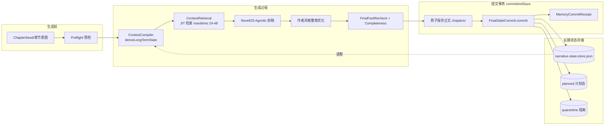

# MEMORY-1 现状盘点与基线冻结交付物

> **状态**：已盘点（2026-08-11）。对应 `delete/任务列表/20260811上下文压缩任务.txt` 的 MEMORY-1。
> **依据代码**：`v2/core/final-state-commit.ts`、`v2/core/orchestrator-commit-save.ts`、`v2/core/context-compiler.ts`、`v2/core/context-retrieval.ts`、`v2/core/memory/*`。
> **结论**：四类长期叙事状态（CanonState / CharacterState / PromiseLedger / PatternMemory）已具备统一 `MemoryRecord` 权威信封、压缩/回源、事务提交、冲突处理、TTL 分层与权威感知检索；事务顺序为「先原子保存正文 → 后提交状态 → 状态失败回滚正文」。本文件为 MEMORY-1 四项交付物：数据流图、字段盘点表、风险清单、replay 基线报告。

---

## 1. 当前记忆数据流图

### 1.1 高层数据流

### 1.2 事务顺序（已确认，orchestrator-commit-save.commitAndSave）

1. **G7-Checkpoint 代理审批稿 pending 守护**：存在未确认审批稿 → 阻断保存与状态提交。
2. **原子保存正文**（`chapters/{chapterId}.md`，temp→rename）。失败 → hard block，状态不提交（零污染）。
3. **状态提交**（`FinalStateCommit.commit`）：
   - 备份 `narrative-state-store.json`（到 `chapter-approvals/`）；
   - `reanchorStagedStateToFinalText`：seed 派生状态重锚定到 finalText span；
   - 正文扫描派生 PatternMemory；
   - `stage` + `commit`：校验 span/hash → 附加 `MemoryRecord` 信封 → 应用 invalidations → compaction → 写入 planned → 写入 quarantine → `saveStateStore` 原子落盘 → 构建 `MemoryCommitReceipt`；
   - 状态失败 → 回滚刚保存的正文（restore 旧版/删除新版）。
4. **STATE-BRIDGE / CLOSURE-TRACKER advisory**：独立可重建 cache，失败不阻断主链路。

> 关键不变量：正文保存成功后才提交状态；状态失败回滚正文。不存在「正文已保存但状态未提交」或「状态已提交但正文未保存」的半提交。

### 1.3 读取点（检索消费）

- `context-compiler.ts#deriveLongTermState` → `context-retrieval.ts#retrieveNarrativeContext`（JIT working set，`maxItems` 动态缩放 24..48，promptItems 摘要 160 字符/条）。
- `context-retrieval.ts` 对附带 `entry.memory` 信封的条目做权威感知过滤与加权（`isFormalFactEvidence` + authority/epistemic 加权）。
- 检索层 `memory-retrieval.ts#rankMemoryRecords` 提供权威/认识状态排序与 `maxItems/maxChars` 预算控制。

---

## 2. 记忆字段盘点表

### 2.1 NarrativeStateStore 结构（final-state-commit.ts）

| 字段 | 类型 | 说明 | 写入点 | 读取点 |
|---|---|---|---|---|
| `schemaVersion` | number | schema 版本 | save | load |
| `workspaceId` | string | 作品 id | save | load |
| `canon[]` | CanonEntry[] | 世界观/规则/不可违背事实 | FinalStateCommit | 检索/事实复检 |
| `character[]` | CharacterStateEntry[] | 人物位置/关系/能力/伤势/知识/动机 | FinalStateCommit | 检索 |
| `promise[]` | PromiseEntry[] | 伏笔/承诺生命周期 | FinalStateCommit | 检索/overdue |
| `pattern[]` | PatternEntry[] | 重复模式/语言风险 | commitAndSave(正文扫描) | 检索 |
| `expectation[]` | ExpectationEntry[] | 读者期待账本 | FinalStateCommit | 检索/overdue |
| `eventLog[]` | NarrativeStateEntry[] | 历史事件追加 | FinalStateCommit | 审计 |
| `quarantine[]` | NarrativeStateEntry[] | 被拒状态隔离 | FinalStateCommit | 审计 |
| `planned[]` | PlannedStateEntry[] | 计划态（非权威） | FinalStateCommit | Preflight 连续性 |
| `compactionReport` | object | 压缩报告 | compact | 审计 |
| `lastCommittedChapter` | string | 上次提交章节 | FinalStateCommit | 连续性 |
| `updatedAt` | string | 更新时间 | save | load |

### 2.2 StateEntryBase（每类状态共有的基础字段）

| 字段 | 类型 | 说明 | 角色 |
|---|---|---|---|
| `id` | string | 条目 id（如 `canon:world:genre`） | invalidation 引用 |
| `sourceChapter` | string | 来源章节（如 `ch17`） | 可回源 |
| `sourceRef` | string | 原文 span 或生成产物引用（`ch{N}#finalText:{hash}:{start}-{end}`） | A2 可追溯 |
| `confidence` | number | 置信度 | 检索加权 |
| `lastUpdated` | string | 更新时间 | 版本 |
| `version`/`supersedes` | number/string | 版本与替代关系 | 冲突/版本化 |
| `effectiveTo` | string | 失效时间 | superseded |
| `sourceRefs` | string[] | 多来源引用 | 可回源 |
| `memory` | MemoryRecord | **MEMORY-RECORD-1 权威信封**（可选） | 权威检索/回源/TTL |

### 2.3 MemoryRecord 协议（memory-record.ts）

| 字段 | 类型 | 说明 |
|---|---|---|
| `memoryId` | string | 稳定记忆 id |
| `memoryType` | MemoryType | 10 类（working/fact/canon/character/promise/pattern/summary/source_text/plan/diagnostic） |
| `authorityClass` | AuthorityClass | 6 级权威（author_declaration/final_text_explicit/committed_state/system_derived/model_planned/diagnostic_hypothesis） |
| `epistemicStatus` | EpistemicStatus | 7 态认识（declared/confirmed/derived/planned/hypothesis/disputed/superseded） |
| `lifecycleStatus` | LifecycleStatus | 5 态生命周期（active/expired/superseded/conflicted/archived） |
| `sourceChapter` | number\|null | 来源章节号 |
| `sourceRef` | string[] | 回源引用（含 hash+span） |
| `textHash` | string[] | 正文 hash 锚 |
| `sourceRunId` | string | 生成运行 id（追溯） |
| `sourceFinalTextHash` | string\|null | 绑定最终正文 hash |
| `createdAt`/`updatedAt` | string | 时间戳 |
| `expiresAt` | string\|null | TTL 到期时间 |
| `confidence` | number\|null | 置信度 |
| `derivedFromMemoryIds` | string[] | 派生证据链 |
| `supersedesMemoryIds` | string[] | 替代关系 |
| `payload` | MemoryPayload | 分类型 payload schema |

### 2.4 分类型 payload schema

| memoryType | payload.data | 压缩策略 |
|---|---|---|
| `canon`/`chapter_fact` | StructuredFactPayload（value/category/key） | none（禁止自由压缩） |
| `character` | StructuredFactPayload | summary_with_ref（结构化权威） |
| `promise` | PromiseLedgerPayload（promiseId/description/status/heat/payoffWindow） | none（保留生命周期） |
| `pattern` | PatternPayload | high_abstract |
| `chapter_summary` | ChapterSummaryPayload（sceneFlow/emotionChange/sourceExcerpts） | summary_with_ref |
| `source_text` | SourceTextPayload | none（原文不覆盖） |
| `plan` | PlanPayload | none（不得进正式检索） |
| `diagnostic` | DiagnosticPayload（含 ttlSeconds） | decay（TTL） |
| `working` | {note} | decay（会话级） |

---

## 3. 风险清单

| # | 风险 | 等级 | 现状缓解 | 剩余风险/待办 |
|---|---|---|---|---|
| R1 | 自由文本摘要覆盖结构化事实 | 高 | validateMemoryRecord 强制 StructuredFactPayload 含 category/key | 低（已守门） |
| R2 | 计划状态晋升为事实 | 高 | canPromoteEpistemicStatus + isFormalFactEvidence 排除 planned/hypothesis | 低（已守门） |
| R3 | 摘要套摘要导致偏离原意 | 高 | detectSummaryOfSummary 拒绝无 sourceRef 的二次摘要 | 需 MEMORY-7 长期验证 |
| R4 | 状态先于正文保存提交（半提交） | 高 | commitAndSave 先原子保存正文，状态失败回滚正文 | 低（已守门） |
| R5 | 硬冲突静默覆盖 | 高 | detectMemoryConflicts → hard_conflict_blocked + FailureEnvelope | 冲突需人工裁决流程 |
| R6 | 被阻断稿/失败稿污染状态 | 高 | 状态只在 commitAndSave 提交；Agentic/优化失败稿不进状态 | 需 MEMORY-7 验证 |
| R7 | 过期诊断进入事实上下文 | 中 | evaluateTtl + tierForMemory + shouldDefaultRetrieve | 低（已守门） |
| R8 | 无法从摘要回源 | 中 | resolveMemorySource fail-closed（hash 不匹配拒绝） | 正式摘要必须含 span |
| R9 | 长期记忆导致上下文无限膨胀 | 中 | maxItems 24-48 + maxChars 预算 | 生产仍完整注入（Phase6 冻结） |
| R10 | 身份/关系/生死硬事实漂移 | 高 | 语义支持校验（REAL-QUALITY-4A）+ 版本化 | 需 MEMORY-7 20/50/100 章验证 |
| R11 | 已兑现 Promise 重复激活 | 中 | PromiseLedger 状态机 + status | 需 MEMORY-7 验证 |
| R12 | 模型服从旧摘要忽略新正文 | 中 | 新正文 supersedes 旧版 + 权威加权 | 需 MEMORY-7 验证 |

---

## 4. Replay 基线报告

### 4.1 基线口径（冻结）

- **生产路径**：`novel_generate_chapter` → 统一主链路，四类状态完整注入（`rel-000` + 9 专用工具）。
- **上下文注入**：`ContextCompiler.deriveLongTermState` → `retrieveNarrativeContext`，`maxItems` 动态缩放 24..48，promptItems 摘要 160 字符/条。
- **Phase 6 冻结决策**（`docs/phase6-context-compression-design.md`）：不启用上下文压缩、不删减状态类；压缩方案未通过真实 replay 前不移交生产。
- **路由**：`config/model-routing.json` v4.31.0；上下文 A/B 使用 `v2_rawstage2_gemini31`（Gemini 3.1 Pro Preview）。

### 4.2 现有 replay 证据

| 依据 | 类型 | 结论 |
|---|---|---|
| `docs/phase6-context-compression-design.md` | 两轮独立消融 replay（各 135 场景） | 无状态类稳定显著，不构成压缩依据 |
| `scripts/context-ab-replay.mjs` | 单因素消融 A/D_pm | PatternMemory 排除无稳定显著差异 |
| `scripts/context-ab-ablation-replay.mjs` | D_mi/D_sl/D_pm_sl | 减 maxItems/摘要长度 token 降但质量退化/超时，不采用 |

**上下文成本基线（eval-only 口径）**：`contextBlockTokens` 收益仅度量长期状态注入块；`schemaTokenCost` 与状态注入正交，不计入压缩收益。质量底线：mustVerify 覆盖率、sourceRef 完整率、empty/errors/timeouts/stopRate。

### 4.3 20/50/100 章连续 replay 基线（待 MEMORY-7 建立）

> **诚实声明**：截至本文件，**尚不存在**连续 20/50/100 章的完整生产链路 replay 基线。现有 replay 均为 eval-only 工具决策口径（单场景 A/B），非连续章节记忆保持验证。MEMORY-7 必须建立连续章节 replay 并达到「硬事实零漂移」后，才能声明长期记忆产生正收益。

必须监控的硬事实指标（MEMORY-7 验收口径）：
- 身份/生死/关系硬事实保持率（20/50/100 章各 100%）；
- 因果链丢失数 = 0；
- 人物知识边界错误 = 0；
- 已兑现伏笔重复出现 = 0；
- 未兑现承诺被误标完成 = 0；
- 计划状态被误当事实 = 0；
- 被阻断稿污染正式状态 = 0；
- 摘要语义保持率 ≥95% 且关键事实不丢失；
- 状态冲突被静默覆盖 = 0；
- 无法从摘要返回原文 = 0。

---

## 5. MEMORY-1 完成度

- [x] 盘点四类长期状态 schema / 写入点 / 读取点（§2）
- [x] 标记自由文本摘要、状态推断、历史正文索引（§2.4 / R1）
- [x] 确认 FinalStateCommit 与 AtomicSave 真实事务顺序（§1.2）
- [x] 建立 20/50/100 章 replay 基线 → 由 `scripts/memory-long-form-replay.mjs` 提供（确定性模拟，见 MEMORY-7）