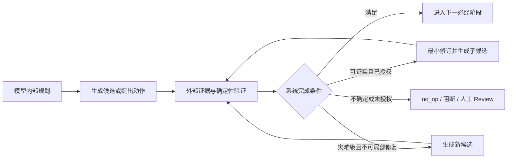

# PiNovelStudio 模型内部推理、外部验证与最小修订边界开发计划

**任务编号**：`REASONING-REPAIR-BOUNDARY-1`  
**版本**：v1.1  
**日期**：2026-08-16  
**状态**：Wave 0–4 代码已接线。Wave 5（真实 replay）已完成（3 样本：2 ok + 1 blocked，Gemini 3.1）；Wave 6（清理/发布验收）已完成（clean checkout 4276 pass, 0 fail）；Step 5（单一事实来源收敛）已验证完成（四类概念均单一来源，零并行 schema）。轮候 Step 6：active_prod 指针切换（需用户明确授权）。  
**适用范围**：`novel_generate_chapter -> NovelOS Agentic -> NarrativeVerifier -> Repair -> 作者风格整章优化 -> StoryPreservation -> FinalFactRecheck -> Completeness -> FinalStateCommit`

### 发布验收状态（2026-08-16）

| 项 | 状态 | 证据 / 说明 |
|---|---|---|
| Wave 0–4 代码接线 | 已接线，非发布完成 | 修订授权、不可变候选、reservation 一次性消费、`expiresAt` persist/consume、无 verifier 不推进 current pointer |
| 无 verifier 不写 `current-candidate.json` | 本轮收口 | `tests-eval/novelos-agent-loop.test.mjs` |
| reservation `expiresAt` | 本轮收口 | `v2/core/repair-authorization-ledger.ts` persist + consume 校验；过期/缺失/到期点拒绝 |
| Wave 5 矩阵 / 故障注入 / 真实 replay | **已完成** | 3 样本真实 Gemini 3.1 生成：rrb-replay-a (blocked, FactGuard hard)、rrb-replay-b (ok, ch1 2 candidates)、xinmo-replay-wave5 (ok, ch18 2 candidates, 17 章历史状态)。RRB-6.4 字段全部验证通过（候选 lineage/hash/授权/validatorRuns/modelCalls/FailureEnvelope/trace 保留）。报告：`reports/rrb-real-replay/rrb-real-replay.json` |
| `npm run simplicity-gate` | **已通过** | 2026-08-17 更新豁免清单至 20 项（新增 eval-only 文件与 planned-refactor 文件），`simplicity-gate-exemptions.json` 已同步至 clean checkout |
| Wave 6 清理 / 文档 / 发布 | **已完成** | RRB-6.5 clean checkout 全量验收（4276 pass, 0 fail）；RRB-6.6 旧生产写入路径已物理删除；RRB-6.7 文档已更新 |
| 生产发布验收 | **待用户授权** | Step 5 单一事实来源已验证完成（§12.5）；轮候 Step 6（active_prod 指针切换，需用户明确授权） |

## 1. 计划结论

本板块不新增通用 Critic，不增加固定的长篇“自我批判”回合，也不引入第二个模型充当文学裁判。开发目标是把现有 Agentic 生成与修订循环收敛为以下唯一控制模型：



最终边界为：

> 允许模型自由思考和提出修订动作，但模型不能自行授予正文修改权。任何正文变化都必须可定位、可证明、可拒绝、可回放，并产生新的不可变候选。

### 1.1 四层职责

| 层级 | 允许产出 | 权限边界 | 持久化边界 |
|---|---|---|---|
| 模型内部规划 | 隐藏推理、检索判断、写作安排 | 可决定下一动作，不可作为事实或授权 | 不保存原始思维链 |
| 结构化自检 | 不确定项、待核验事实、证据需求 | 只能触发检索、验证或 `no_op` | 只保存摘要和引用 |
| 外部验证 | finding、span、权威证据、确定性、hash | 可阻断；满足全部条件后可请求系统授权 | 保存可回源证据与结果 |
| 文学诊断 | 风格、节奏、张力、AI 腔、读者感受 | 只进入 Review Surface，不自动覆盖正文 | 保存 advisory，不生成 repair authorization |

## 2. 当前基线与缺口

以下状态基于 2026-08-16 当前工作树的只读核查。工作树含大量用户在途修改，执行者不得恢复、暂存、删除或覆盖无关内容。

| 范围 | 当前实现证据 | 状态 | 本计划处置 |
|---|---|---|---|
| 不保存原始思维链 | `unified-orchestrator.ts` 记录 `decisionMode`、工具调用、coverage、停止原因，并明确不记录原始思维链 | 已实现，需回归守护 | 保留；增加 trace schema 负向断言 |
| MustVerify 外部覆盖 | `must-verify-coverage-gate.ts` 已要求 confirmed、`sourceRef`、同一 snapshot | 已实现但证据身份未闭环 | 与权威证据 hash 联合校验 |
| 硬失败准入 | `narrative-verifier-suite.ts` 仅收集 `hard/fatal + deterministic/corroborated` | 已实现 | 保留为必要条件，但不再视为充分授权 |
| 有界修订 | `narrative-agent-loop.ts` 已有轮次、预算、停滞退出；未清零由生产编排器阻断 | 已实现，需细化停止原因 | 增加授权耗尽、新 hard finding、stale parent 等原因 |
| span 外不变 | `candidate-patch-service.ts` 已校验 prefix/suffix/gap | 部分实现 | 改为按本轮全部授权 span 联合校验 |
| comparator 拒绝保留原文 | 退化检查返回 `accepted=false` | 已实现，需指针级断言 | 拒绝后不得创建当前候选或移动 current pointer |
| 必经终检 | StoryPreservation、FinalFactRecheck、Completeness 失败均阻断提交 | 已实现，需回归守护 | 禁止 silent degrade，保留现有阶段顺序 |
| 证据权威 | 部分 verifier 将 `diagnostic.id` 直接写入 `sourceRef`；`EvidenceRecord.sourceContentHash` 仍可能为空 | **P0 缺口** | sourceRef 只作定位符；授权必须校验 authority、snapshot、excerpt hash |
| 修订权限 | 生产 loop 已删除 full-chapter rewrite fallback；整章 range 升 `new_candidate`，不再按 span 大小隐式升级完整正文输出 | 已接线，需 Wave 5 回归 | 保持显式灾难白名单；禁止恢复 rewrite fallback |
| 候选不可变 | 初稿走 `createCandidate`；`current-candidate.json` 仅在 verifier 通过后 `advanceCurrentCandidate`；无 verifier 不得写 current pointer | 已接线，需 Wave 5 回归 | 保留 append-only artifact；拒绝覆盖式 draft 作为生产写路径 |
| 多 span 校验 | 当前对每个 proposal 分别用单 span 检查同一 patchedText | **P0 缺口** | 对本轮授权 span 规范化后一次性联合校验 |
| 新 hard finding | reverify 后即把 `currentText` 指向 patchedText，只以 finding 数量判断进展 | **P0 缺口** | 新增 hard finding 时整轮拒绝，current pointer 保持不变 |
| 调用计量 | 同步 `verifier.verify()` 被累计进 `verifyModelCalls` / `modelCallsByKind.verify` | **P0 缺口** | 分为 `validatorRuns` 与真实 `modelCalls`，删除生产旧口径 |

### 2.1 复用与禁止重复建设

本计划必须复用以下现有协议和真相源：

- 权威类型复用 `AuthorityClass`，不再创建一套不兼容的 `evidenceAuthority` 枚举。
- 证据身份扩展现有 `EvidenceRecord`；`snapshotId` 承担 source snapshot 语义，新增 `evidenceExcerptHash`，补齐非空 `sourceContentHash`。
- 候选关系复用 `AgentLineage`、`agent-lineage-index.ts` 的 `candidateId / sourceCandidateId / parentCandidateId`。
- 裁决复用 `OrchestratorDecision`；模型 proposal 不能直接改变当前候选或阶段状态。
- 审计复用 `AuditEvent` 的 `candidate_created / candidate_derived / gate_evaluated / repair_started / repair_completed`。
- 文学软诊断继续进入现有 Review Surface，不新增机器文学 judge。

不得新增第二套 Candidate store、EvidenceRecord、权限枚举、审计事件库或生产 trace 真相源。若字段语义已有，只扩展或迁移现有协议。

## 3. 正式修订权限模型

### 3.1 修订阶梯

```text
no_op
  -> sentence/span patch
  -> paragraph patch
  -> bridge patch
  -> new candidate generation
```

`new candidate generation` 是生成新的完整候选，不是覆盖父候选的 `chapter_rewrite`。作者风格整章优化是独立、必经的转换阶段，不属于 repair；它继续产出派生候选并接受 StoryPreservation、FinalFactRecheck 和 Completeness 约束。

| finding/情形 | 允许动作 | 限制 |
|---|---|---|
| 启发式、不确定、文学软诊断、证据不足 | `no_op` 或人工 Review | 自动修改次数必须为 0 |
| 可定位格式损坏、重复污染、实体/属性冲突 | sentence/span patch | 必须有权威证据和有效 span |
| 有权威事实且落点明确的事实遗漏 | paragraph patch | 不能用整章范围代替缺失落点 |
| 两个确定场景锚点间的时间/空间断裂 | bridge patch | 同时绑定前后锚点和联合授权范围 |
| 截断、整体契约失败、无法定位的关键事件缺失 | new candidate generation | 生成新候选；不复用 repair prompt 覆盖父候选 |
| 作者输入自相矛盾 | 阻断并要求修订输入 | 正文修订不得掩盖输入冲突 |

### 3.2 自动修订准入条件

自动修订必须同时满足：

```text
hard finding
AND deterministic/corroborated
AND authoritative EvidenceRecord
AND same source snapshot
AND non-empty sourceContentHash + evidenceExcerptHash
AND valid authorized repair span(s)
AND repair type explicitly allowed for failure type
AND system-issued authorization decision
AND bounded repair budget available
```

任一条件不满足时，决策只能是 `no_op`、`request_new_candidate`、`block` 或 `human_review`，不得修改正文。

### 3.3 RepairAuthorization

Phase 0 冻结以下最小契约。命名可在实现评审时微调，但不得弱化字段或形成平行裁决协议。

```ts
interface RepairAuthorization {
  authorizationId: string;
  orchestratorDecisionId: string;
  candidateId: string;
  candidateTextHash: string;
  findingIds: string[];
  evidenceIds: string[];
  snapshotId: string;
  evidenceExcerptHashes: string[];
  action:
    | "no_op"
    | "span_patch"
    | "paragraph_patch"
    | "bridge_patch"
    | "new_candidate"
    | "block"
    | "human_review";
  authorizedRanges: TextSpan[];
  budgetReservationId: string | null;
  issuedBy: "orchestrator" | "system";
  reasonCode: string;
  expiresAt: string;
}
```

不变量：

- 模型返回的 `approved / authorized / severity / sourceRef` 字段不能生成授权。
- 授权绑定父候选 hash；父候选内容变化、snapshot 变化或预算 reservation 失效时授权立即失效。
- `authorizedRanges` 必须规范化、非越界、非重叠；零宽插入只允许显式白名单情形。
- `new_candidate` 的 `authorizedRanges` 必须为空，且进入新的生成请求，不进入 patch merger。
- 授权只对一次执行有效；重试必须产生新 authorization 或结构化停止。

## 4. 不可变候选与谱系

### 4.1 CandidateRevisionManifest

每次初稿、成功 patch、新候选生成和作者风格转换都必须生成独立 manifest：

```ts
interface CandidateRevisionManifest {
  candidateId: string;
  chapterId: string;
  parentCandidateId: string | null;
  sourceCandidateId: string | null;
  derivationType:
    | "agentic_generation"
    | "span_patch"
    | "paragraph_patch"
    | "bridge_patch"
    | "new_candidate"
    | "author_style_transform"
    | "user_edit";
  textArtifactRef: string;
  textHash: string;
  parentTextHash: string | null;
  diffArtifactRef: string | null;
  diffHash: string | null;
  authorizationId: string | null;
  verifierReportId: string | null;
  createdAt: string;
}
```

### 4.2 存储规则

- 以 `novelos-sessions/{sessionId}/candidates/` 保存不可变候选正文和 manifest；已存在 candidateId 不得覆盖。
- `current-candidate.json` 只保存当前指针、candidateId 和 textHash，并采用原子替换。
- 旧 `draft.md` 覆盖式写入在迁移完成后物理删除；如需兼容读取，只允许只读 adapter，不得继续生产写入。
- candidateId 必须包含运行身份和内容 hash，不能继续使用每章固定 ID 表示多轮不同正文。
- comparator 或 post-verification gate 拒绝时，可以保存 rejected artifact 供审计，但不能移动 current pointer。
- trace 只存 manifest、diff 摘要和 hash；正文进入受控 artifact，不内嵌到所有审计事件。

## 5. 实施阶段

### Phase 0：基线冻结、契约映射与 RED 测试（P0）

**目标**：在不改变生产行为的前提下固定修订授权、候选身份、计量和停止原因。

**任务**：

- `RRB-0.1`：输出现有 finding -> feedback -> proposal -> patch -> reverify -> candidate -> commit 调用点清单，标注写入、授权和 hash 边界。
- `RRB-0.2`：冻结 `RepairAuthorization`、`CandidateRevisionManifest`、修订阶梯、failure type 映射和 reason code。
- `RRB-0.3`：建立与现有 `EvidenceRecord / AuthorityClass / OrchestratorDecision / AgentLineage / AuditEvent` 的字段映射，禁止平行 schema。
- `RRB-0.4`：建立 RED 测试，稳定证明六项缺口：diagnostic ID 可穿过 sourceRef、40% 阈值触发完整正文模式、draft 被覆盖、联合 span 误判、新 hard finding 后 currentText 仍推进、validator 被计作 model call。
- `RRB-0.5`：冻结现有修订轮数、模型路由和预算基线；本计划不顺手增加修订次数或模型 fallback。

**完成标准**：契约评审通过；RED 在旧实现稳定失败；没有生产行为变化；形成独立 Wave 0 基线报告。

### Phase 1：证据身份与授权闸门（P0）

**目标**：把“finding 可修”从字段存在判断升级为可回源的系统授权。

**任务**：

- `RRB-1.1`：扩展 `EvidenceRecord`，补齐非空 `sourceContentHash` 和 `evidenceExcerptHash`；校验 `sourceRef` 能回源到同一 `snapshotId`。
- `RRB-1.2`：为 verifier finding 增加 `evidenceId` 或等价引用；`diagnostic.id` 只能作为 finding identity，不能充当权威 sourceRef。
- `RRB-1.3`：实现 `RepairAuthorizationPolicy`，按第 3.2 节逐项 fail-closed；只有 orchestrator/system 可签发。
- `RRB-1.4`：冻结 failure type -> allowed action 白名单；删除 default-to-sentence-patch 行为，未知类型默认 `no_op/block`。
- `RRB-1.5`：将文学软诊断、heuristic finding、author input conflict 和无有效 span finding 显式路由到 `human_review/no_op/block`。
- `RRB-1.6`：授权绑定 candidate hash、snapshot、evidence hash、范围和预算；stale/missing/mismatch 均生成可解释 FailureEnvelope 或决策记录。

**重点文件**：

- `v2/core/evidence-governance-contracts.ts`
- `v2/core/evidence-record-adapter.ts`
- `novelos/verification/narrative-verifier-types.ts`
- `novelos/verification/narrative-verifier-suite.ts`
- `novelos/verification/verification-feedback-compiler.ts`
- 新增或扩展现有 orchestrator decision 模块中的 repair authorization policy

**完成标准**：无权威 EvidenceRecord 的自动修改次数为 0；diagnostic ID 不能授权；授权 stale 时正文 hash 不变。

### Phase 2：不可变候选存储与血缘（P0）

**目标**：原始 Agentic 候选、每轮修订候选、重生成候选和作者风格候选形成完整不可变谱系。

**任务**：

- `RRB-2.1`：实现 CandidateRevision manifest 的创建、schema 校验、hash 和 append-only 写入。
- `RRB-2.2`：将 `CandidateWorkspace.writeDraft()` 迁移为 `createCandidate()` + `advanceCurrentCandidate()`；两步必须分离。
- `RRB-2.3`：patch 成功后生成新 `candidateId + parentCandidateId + diff + hash`；原正文和 manifest 永不变化。
- `RRB-2.4`：`new_candidate` 创建新的完整正文候选并关联失败父候选；不得调用 full rewrite merger 覆盖父候选。
- `RRB-2.5`：作者风格整章优化标记为 `author_style_transform`，与 repair 类型和预算分离。
- `RRB-2.6`：把所有候选接入现有 `AgentLineage`、lineage index 和 AuditEvent；拒绝/阻断候选也可回放。
- `RRB-2.7`：迁移后删除生产固定 `candidate:agentic_raw:{chapterId}` 多正文身份和覆盖式 `draft.md` 写路径。

**重点文件**：

- `novelos/agent/candidate-workspace.ts`
- `novelos/agent/narrative-agent-loop.ts`
- `novelos/agent/agentic-raw-candidate-source.ts`
- `v2/core/types.ts`
- `v2/core/agent-result-contracts.ts`
- `v2/core/agent-lineage-index.ts`
- `v2/core/audit/*`

**完成标准**：任意父候选 artifact/hash 在后续轮次保持不变；current pointer 只能指向已接受且已复验候选；谱系可从最终候选回溯到原始 Agentic 候选。

### Phase 3：最小修订执行器与显式新候选路径（P0）

**目标**：修订范围由授权决定，绝不由 span 大小推导整章权限。

**任务**：

- `RRB-3.1`：删除 `spanLength < draft.length * 0.4` 对输出模式的权限含义；span 过大只能拒绝、缩小授权或走显式 `new_candidate`。
- `RRB-3.2`：删除生产 `buildFullRewritePrompt` repair fallback；完整正文只能由独立 new-candidate generation 入口产生。
- `RRB-3.3`：实现多 span 联合应用和联合不变性校验；一次规范化全部 authorized ranges，并对 range 外文本逐字校验。
- `RRB-3.4`：bridge patch 必须携带前后确定锚点；无两个权威锚点时 `no_op/human_review`。
- `RRB-3.5`：comparator 输入改为 parent candidate、child candidate、authorization 和联合 diff；拒绝后不推进 current pointer。
- `RRB-3.6`：post-verification acceptance gate 检测 `newHardFindingIds`、严重度升级和证据冲突；任一出现即拒绝 child。
- `RRB-3.7`：只有 hard finding 集合严格收敛且未新增 hard finding时才允许 child 成为 current；不能只比较 finding 数量。

**重点文件**：

- `novelos/agent/candidate-patch-service.ts`
- `novelos/agent/narrative-patch-merger.ts`
- `novelos/agent/narrative-repair-selector.ts`
- `novelos/agent/narrative-agent-loop.ts`

**完成标准**：生产 repair 路径不存在完整正文输出 fallback；范围外变化为 0；新 hard finding child 被拒绝；多 span 合法修订可通过联合校验。

### Phase 4：验证循环、计量与停止解释（P0）

**目标**：把本地 validator、真实模型调用、修订轮次和停止原因准确分账。

**任务**：

- `RRB-4.1`：将 `modelCallsByKind` 收敛为真实模型调用，例如 `draft / patch / newCandidate / authorStyle`；同步 verifier 不得计入 modelCalls。
- `RRB-4.2`：新增 `validatorRuns`，至少区分 coverage gate、narrative verifier、patch comparator、span immutability、StoryPreservation、FinalFactRecheck、Completeness。
- `RRB-4.3`：模型 wrapper 成为 model call 唯一计数点；validator runner 成为 validator run 唯一计数点，禁止调用方手工 `+= 1`。
- `RRB-4.4`：停止原因收敛为结构化枚举：`cleared / budget_exhausted / stagnant / no_authorized_action / stale_authorization / comparator_rejected / new_hard_finding / request_new_candidate / blocked`。
- `RRB-4.5`：停滞判断比较 finding identity、severity、evidence 和 candidate hash；同数量但 finding 换新不得视为进展。
- `RRB-4.6`：修订预算同时约束模型调用、授权次数、候选数量和 validator runs，防止只限制其中一个维度。
- `RRB-4.7`：删除生产 trace 的旧 `modelCallsByKind.verify`；历史 artifact 如需读取，只在只读投影层映射并标注 `legacy_misclassified_validator_run`。

**完成标准**：本地 verifier 运行增加时 modelCalls 不变；真实 patch 调用准确计数；每次退出都有单一、可解释 stopReason 和预算快照。

### Phase 5：统一编排、审计与 Review Surface（P0）

**目标**：把授权、候选、验证和最终提交接入单一生产主链路，不增加入口或 Critic。

**任务**：

- `RRB-5.1`：`runUnifiedPipeline` 只接受已清零且 lineage/hash 完整的 Agentic current candidate。
- `RRB-5.2`：作者风格整章优化继续作为独立必经转换；其结果必须创建派生候选并重新执行 StoryPreservation、FinalFactRecheck、Completeness。
- `RRB-5.3`：任何 verifier 未清零、authorization 不完整、candidate hash 不一致或 lineage 断裂时，章节文件、长期状态和 commit receipt 均不得产生。
- `RRB-5.4`：AuditEvent 记录 decision summary、evidence refs/hash、授权范围、动作、parent/child candidate、接受/拒绝结果和 stopReason；禁止记录原始思维链。
- `RRB-5.5`：文学软诊断只投影到 Review Surface；增加生产计数断言 `literary_advisory_auto_edits=0`。
- `RRB-5.6`：FailureEnvelope 区分 `verification_blocked`、`repair_unauthorized`、`candidate_integrity`、`repair_stagnant`、`new_candidate_required`；禁止笼统“修订失败”。
- `RRB-5.7`：保留 `novel_generate_chapter` 唯一公开生成入口；不得暴露 repair、new candidate 或 verifier 为可绕过编排器的公开正文入口。

**完成标准**：所有正文修改都有系统授权与 parent/child 证据；所有未清零路径零提交；文学 advisory 自动修改为 0；公开入口数量不变。

### Phase 6：评测、真实回放与版本收敛（P0）

**目标**：证明边界在确定性、真实 workspace、故障和长链路场景下成立，并删除旧生产实现。

**任务**：

- `RRB-6.1`：完成第 7 节最小验收矩阵的单元、集成和故障注入测试。
- `RRB-6.2`：至少选择两个真实 workspace 做完整 `novel_generate_chapter` replay，覆盖零修订、单 span、多 span、bridge、新候选、停滞和阻断。
- `RRB-6.3`：验证相同写作/修订模型与不同模型两种路径；准入结果必须只取决于外部证据与系统授权，不取决于“换了模型”。
- `RRB-6.4`：核对每个样本的 candidate lineage、text/diff hash、authorization、validatorRuns、modelCalls、FailureEnvelope 和 trace 留存。
- `RRB-6.5`：从 clean checkout 执行构建、focused tests、完整测试、eval、simplicity gate、dependency boundary 和 audit。
- `RRB-6.6`：新实现通过后物理删除覆盖式 draft 写入、固定 candidate ID、多正文完整 rewrite repair、旧 verifyModelCalls 生产口径和重复 schema。
- `RRB-6.7`：更新架构真相源、project-memory、审计 runbook 和发布证据；只保留一个最新生产版本。

**完成标准**：第 8 节全部门槛通过；真实 replay trace 留存率 100%；生产依赖闭包不含被替换的旧写入、旧权限升级或旧计量路径。

## 6. 建议开发波次与分工

`负责人` 留给排期时填写；复杂度是相对值，不等同于自然日。

| 波次 | 工作包 | 优先级 | 复杂度 | 建议角色 | 依赖 | 可并行 | 负责人 |
|---|---|---:|---:|---|---|---|---|
| Wave 0 | RRB-0.1~0.5 基线、契约、RED | P0 | M | 架构 + 测试 | 无 | 调用点盘点与 RED 可并行 |  |
| Wave 1A | RRB-1.1~1.2 EvidenceRecord/finding 身份 | P0 | M | 证据治理 | Wave 0 | 与 1B 并行 |  |
| Wave 1B | RRB-2.1~2.2 Candidate manifest/store 骨架 | P0 | L | 存储 + 核心链路 | Wave 0 | 与 1A 并行 |  |
| Wave 2A | RRB-1.3~1.6 RepairAuthorizationPolicy | P0 | L | 权限 + 编排 | Wave 1A | 与 2B 并行 |  |
| Wave 2B | RRB-2.3~2.7 不可变候选与 lineage | P0 | L | Agentic + 审计 | Wave 1B | 与 2A 并行 |  |
| Wave 2C | RRB-4.1~4.3 计量基础设施 | P0 | M | 可观测性 | Wave 0 | 与 2A/2B 并行 |  |
| Wave 3 | RRB-3.1~3.7 最小修订执行器 | P0 | L | Agentic repair | Wave 2A + 2B | 用例与实现可拆分 |  |
| Wave 4A | RRB-4.4~4.7 循环和停止解释 | P0 | M | Agentic + 预算 | Wave 2C + 3 | 与 4B 部分并行 |  |
| Wave 4B | RRB-5.1~5.3 主链路提交门禁 | P0 | L | Orchestrator | Wave 2B + 3 | 与 4A 部分并行 |  |
| Wave 4C | RRB-5.4~5.7 审计/Review/入口边界 | P0 | M | 审计 + 产品边界 | Wave 2A + 2B | 与 4A/4B 并行 |  |
| Wave 5 | RRB-6.1~6.4 矩阵、故障注入、真实 replay | P0 | L | Eval + 集成 | Wave 4 | 场景可并行 | 未完成；现有 `rrb-real-replay.json` 不是本波次证据 |
| Wave 6 | RRB-6.5~6.7 清理、文档、发布 | P0 | M | 发布治理 | Wave 5 | 清理后验证必须串行 | 未开始；simplicity-gate 仍失败 |

### 6.1 关键路径

```text
Wave 0 契约与 RED
  -> Wave 1A 证据身份
  -> Wave 2A 修订授权
  -> Wave 3 最小修订执行器
  -> Wave 4 主链路收口
  -> Wave 5 真实 replay
  -> Wave 6 旧路径删除与发布

Wave 1B 候选存储 -> Wave 2B 不可变谱系 ----^ 
Wave 2C 计量基础设施 -> Wave 4A 循环计量 --^
```

### 6.2 合并边界

- 每个 Wave 先合并契约/RED，再合并生产实现；不得在同一大提交中同时改协议、实现和全部基线。
- Wave 1A/1B、Wave 2A/2B/2C 可并行，但共享类型必须在 Wave 0 冻结后再开工。
- Candidate store、authorization policy 和 repair executor 必须由不同 focused test 保护；集成前不得互相复制临时类型。
- 迁移期间新旧格式可在 test/eval 中短期读取，生产只能有一个写入权威；晋级后同一发布物理删除旧写路径。
- 当前工作树有大量在途改动。每个工作包必须先保存只读 status/diff 快照并限定文件清单，不得处理无关修改或 stash。

## 7. 最小验收矩阵

| ID | 场景 | 预期 |
|---|---|---|
| T01 | `sourceRef` 只是 diagnostic ID | 不得签发 repair authorization |
| T02 | EvidenceRecord 缺 authority/snapshot/source hash/excerpt hash 任一项 | `no_op/block`，正文 hash 不变 |
| T03 | evidence snapshot 与 candidate run 不一致 | stale authorization，零修改 |
| T04 | hard + heuristic finding | 不进入自动修订 |
| T05 | review/info 文学诊断 | 只进入 Review Surface，自动修改 0 次 |
| T06 | 可定位实体/属性硬冲突 | 只授权目标 span/paragraph |
| T07 | 两个确定场景锚点间断裂 | 可授权 bridge patch；缺任一锚点则不授权 |
| T08 | span 覆盖 40% 以上但无灾难授权 | 不进入完整正文输出；`no_op/block/new_candidate request` |
| T09 | 截断或整体契约失败 | 生成新 candidate，不覆盖父候选 |
| T10 | 多个不重叠 span 同轮修订 | 按授权范围联合校验并正确应用 |
| T11 | span 重叠、越界或倒置 | 整轮拒绝，current pointer 不变 |
| T12 | 任一授权 span 外有一字变化 | 整轮拒绝 |
| T13 | comparator 拒绝 | parent/current candidateId 与 hash 不变 |
| T14 | patch 解决旧 finding 但产生新 hard finding | child 拒绝，不成为 current |
| T15 | hard finding 数量相同但 identity 更换 | 不视为进展；结构化停滞/拒绝 |
| T16 | patch 通过全部门禁 | 生成新 candidateId、parentCandidateId、textHash、diffHash |
| T17 | 后续再 patch | 所有祖先 artifact/hash 不变，可完整回溯 |
| T18 | 作者风格整章优化 | 标记独立 transform，不消耗 repair authorization |
| T19 | 相同模型负责写作与局部修复 | 可执行；授权仍只来自外部证据和系统 |
| T20 | 模型输出 `approved=true` 或伪造 sourceRef | 不改变系统授权结果 |
| T21 | 本地 verifier 执行两次 | `validatorRuns += 2`，`modelCalls += 0` |
| T22 | patch 模型真实调用一次 | `modelCalls.patch += 1`，validator 单独计数 |
| T23 | 修订预算耗尽或连续停滞 | 有界退出并记录明确 stopReason |
| T24 | verifier 未清零 | 正文文件、状态、commit receipt 均不产生 |
| T25 | StoryPreservation/FinalFactRecheck/Completeness 任一失败 | 不静默降级，不提交 |
| T26 | trace schema 扫描 | 只含摘要、证据、动作、hash；不含原始思维链 |
| T27 | 生产工具注册 | `novel_generate_chapter` 仍是唯一公开章节生成入口 |
| T28 | clean checkout 生产构建 | dist 不含 full-rewrite repair fallback、覆盖式 draft 写入或 verifyModelCalls 旧口径 |

## 8. 生产验收门槛

| 指标 | 目标 |
|---|---:|
| 无系统授权的正文修改 | 0 |
| 文学软诊断触发自动修改 | 0 |
| diagnostic ID 被当作权威证据 | 0 |
| 无 snapshot/hash 的自动修订 | 0 |
| span 外文本变化 | 0 |
| comparator 拒绝后 current pointer 更新 | 0 |
| patch 新增 hard finding 后获接纳 | 0 |
| 父候选 artifact/hash 变化 | 0 |
| 未清零候选提交 | 0 |
| StoryPreservation/FinalFactRecheck/Completeness 静默降级 | 0 |
| 原始思维链持久化 | 0 |
| candidate lineage 完整率 | 100% |
| repair authorization 可回源率 | 100% |
| modelCalls/validatorRuns 分类准确率 | 100% |
| verification loop 无界执行 | 0 |
| 所有停止原因可解释率 | 100% |
| 真实 replay trace 留存率 | 100% |

这些指标证明修订权限、候选完整性和审计边界，不等同于文学质量提升。文学质量仍由用户对最终正文和后续修改反馈裁决。

## 9. 验证分层

### 9.1 确定性单元测试

- evidence identity、authority、snapshot 和 hash 校验；
- failure type -> allowed action 映射；
- RepairAuthorization 创建、过期、一次性消费和 stale 检测；
- candidate manifest、append-only、current pointer 和 hash；
- 单 span、多 span、零宽、重叠、越界和 range 外不变性；
- comparator 与 post-verification acceptance；
- finding identity 进展与停滞；
- modelCalls/validatorRuns 分账；
- trace redaction 和禁止思维链字段。

### 9.2 生产集成测试

- `runUnifiedPipeline` 的 Agentic -> repair -> AuthorStyle -> final gates -> commit 顺序；
- repair authorization 只能由 orchestrator/system 产生；
- rejected child 不改变 current candidate；
- new candidate 与 local repair 是两条显式、互斥动作；
- 作者风格转换不冒充 repair；
- 未清零、hash mismatch、lineage incomplete 和 audit unavailable 全部 fail-closed；
- 公开工具注册和生产 dependency boundary 不增加入口。

### 9.3 回放与故障注入

- 两个以上真实 workspace，覆盖不同章节位置和事实密度；
- 模型 timeout、patch schema 错误、evidence hash mismatch、candidate store 写失败、audit 写失败；
- 单轮多 finding、连续停滞、预算耗尽、新 hard finding、父候选并发变化；
- 相同模型/不同模型修订对照，只检查授权边界，不用机器文学 judge 选优。

### 9.4 建议验证命令

在 `.pi/extensions/novel-studio` 执行：

```text
npm run build
node --import ./tests/setup-test-env.mjs --test --test-concurrency=1 <本工作包 focused tests>
npm test
npm run test:eval
npm run simplicity-gate
npm audit
```

发布前必须从 clean checkout 重跑生产构建、focused tests、完整测试、eval、dependency boundary、simplicity gate 和真实 replay。单纯 build/test 通过不能宣称本板块完成。

## 10. 风险与处置

| 风险 | 处置 |
|---|---|
| 候选不可变存储增加磁盘量 | 正文内容寻址去重；trace 只存 ref/hash；按既有 artifact 保留策略清理非生产会话 |
| evidence hash 增加适配成本 | 扩展现有 EvidenceRecord adapter；禁止 verifier 自建伪 sourceRef |
| 多 span 联合 patch 解析复杂 | 先规范化范围，再一次性合并和一次性校验；解析失败保留 parent |
| 删除 full rewrite fallback 降低自动成功率 | 将灾难级问题显式路由为 new candidate；成功率不能靠越权覆盖提升 |
| 新候选导致模型成本上升 | 仅灾难白名单可触发；独立预算；不自动无限重生成 |
| 同模型修复延续盲点 | 不要求换模型；用独立证据、确定性 verifier 和系统授权消除自批自准 |
| comparator 只看机械指标 | comparator 只做退化和边界拒绝，不做文学 winner；最终文学评价归用户 |
| 与 CEG/多代理/审计计划重复 | 复用 EvidenceRecord、AgentLineage、OrchestratorDecision、AuditEvent；本计划只补修订权限与候选不可变性 |
| 迁移期间双写长期存在 | test/eval 可短期读兼容；生产只有一个写权威；晋级即删除旧路径 |
| 用户在途工作树被覆盖 | 每个工作包限定文件与 diff，禁止处理无关改动和 stash |

## 11. 非目标

本计划不做：

- 新增通用 Critic、自我批判 Agent 或固定反思回合；
- 把内部思维链、隐藏推理或长篇自省写入 trace；
- 用第二模型的文学判断自动覆盖正文；
- 恢复 opportunity judge、pairwise judge、SelectionPolicy 或机器文学 winner；
- 把 AI 腔、风格、节奏、对白比例、段落长度等软诊断升级为硬修订授权；
- 让 patch、新候选生成或 verifier 成为公开正文入口；
- 把作者风格整章优化降级为 repair 或允许绕过；
- 恢复 one-shot raw、shadow、legacy Stage0-8、generationMode 或章节白名单；
- 以更多修订轮次、更多模型调用或更规整文本宣称文学质量提升；
- 实现下一板块“作者意图不确定性、主动澄清与可逆假设”。该板块另行立项，本计划只保留结构化 `human_review/block` 出口。

## 12. 发布与版本收敛

发布顺序必须为：

1. 冻结契约、字段映射和 RED 基线。
2. 完成证据授权、不可变候选、最小修订、计量和主链路接线。
3. 通过确定性测试、故障注入、真实 replay 和 clean checkout 验证。
4. 将新候选存储、授权政策和计量口径设为唯一生产实现。
5. 同一发布物理删除覆盖式 draft 写入、固定 candidate ID、full rewrite repair fallback、旧 verifyModelCalls 生产字段和重复 schema。
6. 更新依赖边界、架构真相源、project-memory、runbook 和 release evidence。
7. 从 clean checkout 再次执行完整验收后发布。

禁止以 feature flag 长期保留旧修订实现或生产双写。历史 artifact 只允许通过只读 adapter 解释，不得成为可执行回退路径。

## 12.5 单一事实来源收敛（Step 5，2026-08-17 验证完成）

四类关键概念的单一事实来源均已验证（grep 生产 .ts 源码，零并行 schema）：

| 概念 | 唯一定义位置 | 消费方 | 结论 |
|---|---|---|---|
| Context Evidence（`EvidenceRecord`） | `v2/core/evidence-governance-contracts.ts:63` | `context-package-production.ts` / `tool-result-evidence.ts` / `evidence-record-adapter.ts` / `repair-authorization-policy.ts` 均 import | 单一来源 ✓ |
| `AuditEvent` | `v2/core/audit/audit-event-types.ts:256` | `audit-event-schema.ts` / `audit-event-validator.ts` / `audit-event-store.ts` / `trace-projections.ts` / `legacy-trace-compat.ts` 等均 import | 单一来源 ✓ |
| 状态机（`isStatusTransitionValid`） | `v2/governance/evolution-release-schema.ts:398` | `evolution-release-registry.ts` / `release-lifecycle-permissions.ts` 均 import | 单一来源 ✓ |
| `BudgetLedger` | `v2/core/budget-types.ts:160` | `budget-ledger.ts` re-export；`capability-activation-planner.ts` / `unified-orchestrator.ts` 经 re-export 消费 | 单一来源 ✓ |

`repair-authorization-contracts.ts:397-404` 明示设计约束「不得新建第二套 Candidate store / EvidenceRecord / 权限枚举 / 审计事件库」，与实测一致。

**遗留缺口（非单一来源问题，属 §13 可回源性）**：`EvidenceRecord.sourceContentHash` 现为空，需在后续补齐非空以达成 §13「authority、snapshot、sourceContentHash、evidenceExcerptHash 可回源」。此项不影响单一事实来源收敛结论。

## 13. 完成定义

只有以下条件同时满足，任务才可标记完成：

- [ ] 模型 proposal 与系统 authorization 已完全分离；
- [ ] 自动修订满足第 3.2 节全部准入条件；
- [ ] EvidenceRecord 的 authority、snapshot、sourceContentHash、evidenceExcerptHash 可回源；
- [ ] diagnostic ID、heuristic finding 和文学 advisory 无法签发修订授权；
- [ ] 原始 Agentic 候选和所有父候选正文/hash 永不变化；
- [ ] 每次正文变化都产生 child candidate、parent link、diff 和 hash；
- [ ] 生产 repair 不存在按 span 大小升级完整正文输出的路径；
- [ ] 多 span 按授权范围联合校验，range 外逐字不变；
- [ ] comparator 拒绝或出现新 hard finding 后 current pointer 不更新；
- [ ] verifier 未清零时正文、状态和章节文件均不提交；
- [ ] 作者风格整章优化仍是独立必经转换，并经过全部终检；
- [ ] validatorRuns 与 modelCalls 分账准确，旧 verifyModelCalls 生产口径已删除；
- [ ] verification loop 有界，停滞和退出原因可解释；
- [ ] trace 只记录决策摘要、证据、授权、动作和 hash，不记录原始思维链；
- [ ] 第 7、8 节全部用例和指标达标；
- [ ] 两个以上真实 workspace replay 已归档且 trace 留存率 100%；
- [ ] 旧生产实现已物理删除，生产只保留单一最新版本；
- [ ] 构建、完整测试、eval、dependency boundary、simplicity gate、audit 和 clean checkout 验证通过；
- [ ] 架构文档、project-memory、runbook 和发布证据已更新。

完成后，PiNovelStudio 应能对每一次正文变化回答五个问题：

1. 哪个外部 finding 触发了动作；
2. 哪条权威证据和哪个 snapshot 证明了问题；
3. 哪个系统决策授予了哪一种、哪一范围的修订权限；
4. 新候选与父候选具体改变了什么，hash 是否一致；
5. comparator、reverify 和最终门禁为什么接受或拒绝该候选。
