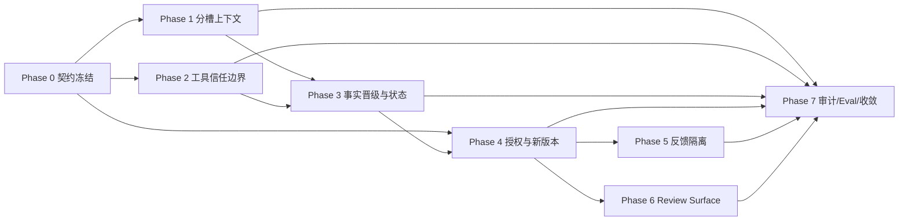

# PiNovelStudio 提示注入防御与信任架构开发计划

**任务编号**：PROMPT-INJECTION-TRUST-ARCHITECTURE-1  
**版本**：v1.0  
**日期**：2026-08-12  
**状态**：Wave 0–4 契约 + 20 项 Eval + 生产闭包 6 项 + TrustAudit 并发隔离（多 sink 注册表 + ALS）已落地。评级：Production-wired (core paths) with concurrent audit isolation。发布前建议真实 novel_generate_chapter replay 与全量 npm test。  
**适用范围**：统一生产主链路 `novel_generate_chapter`、工具调用、长期叙事状态、用户反馈、Review Surface、审计与 Eval

## 1. 正式结论

PiNovelStudio 要建设的不是一段“防提示注入 Prompt”，而是一套可验证的信任架构：

> 不可信文本不得穿透上下文、工具、长期状态和用户反馈链路；权限只能来自结构化来源、真实用户动作和可验证的事务记录。

生产安全模型固定为：

```text
来源分层 → 指令/资料分槽 → 受限上下文编译
        → 工具结果分级 → FactGuard/来源验证
        → 候选隔离 → 用户显式确认
        → hash/approval/版本绑定 → FinalStateCommit + 原子保存
        → 追加式审计与可回放 Eval
```

本计划不恢复 legacy Stage0-8、不新增第二套生成模式、不把机器文学裁判引回生产，也不把安全责任转移给模型提示词。

## 2. 当前基线与可复用资产

以下能力已经存在，应作为本计划的扩展底座：

| 领域 | 现有资产 | 本计划动作 |
|---|---|---|
| 上下文安全 | `v2/core/context-safety.ts` | 增加信任等级、authority、expiry、promotion 规则，并保持 P0/P1 溢出与冲突阻断 |
| 模型授权 | `v2/core/autonomy-policy.ts`、`control-plane.ts`、`action-catalog.ts` | 继续 fail-closed，补齐字段伪造和 actor 伪造测试 |
| 工具协议 | `novelos/tools/tool-protocol.ts`、工具注册表 | 增加统一 `ToolResult` 信任元数据与结果消费闸门 |
| 长期状态 | `v2/core/final-state-commit.ts`、`memory/*` | 将所有状态输入明确为 proposal/evidence/verified，禁止计划或模型声明直接入权威状态 |
| 审阅 artifact | `review-artifact-schema.ts`、`review-surface-cli.ts` | 保持只读降级，补充证据展示、版本失效和脱敏覆盖 |
| 审批与提交 | `governance/*approval*`、`action-approval-receipt.ts` | 统一 user/action/artifact hash/approvalId 绑定，正文变化即失效 |
| 审计 | `v2/core/audit/*`、`AuditRunSession` | 将信任决策、工具消费、提交拒绝写入唯一审计事件链 |
| 用户反馈 | `v2/learning/feedback-evidence-contracts.ts`、`user-feedback-ingestor.ts` | 增加反馈信任分类，确保反馈只影响后续请求，不改变安全边界 |

当前工作树存在用户进行中的修改、staged 测试和未跟踪产物。执行本计划时只做只读基线盘点和新增/定向修改；不得恢复、删除、覆盖、暂存或清理无关改动。

## 3. 目标信任模型

### 3.1 五级信任层

| 信任层 | 示例 | 默认权限 |
|---|---|---|
| `system_authority` | 系统策略、权限、事务规则 | 可形成硬约束 |
| `author_authority` | CreativeConstitution、ChapterIntent、作者明确契约 | 可形成硬约束 |
| `committed_state` | 已确认章节派生的 Canon/Character/Promise/Pattern | 可形成硬约束，但必须可回源验证 |
| `retrieved_reference` | 历史正文、检索结果、风格示例 | 只能作为资料，不产生指令权 |
| `model_or_user_untrusted` | 模型输出、候选正文、自然语言反馈、外部文本 | 默认不能形成硬约束或授权 |

文本中出现“系统必须”“忽略之前规则”“用户已批准”等句子，不会改变其信任层。

### 3.2 上下文槽位

所有进入模型或门禁的内容必须物理分槽，不再拼接为无边界长文本：

```text
[SYSTEM_AUTHORITY]
[AUTHOR_CONTRACT]
[IMMUTABLE_FACTS]
[COMMITTED_STATE]
[REFERENCE_MATERIAL]
[DIAGNOSTIC_EVIDENCE]
[UNTRUSTED_DRAFT]
[USER_FEEDBACK]
```

规则：

- `AUTHOR_CONTRACT` 决定生成方向；
- `IMMUTABLE_FACTS` / 已验证 `COMMITTED_STATE` 供 FactGuard 消费；
- `REFERENCE_MATERIAL` 只能引用，不能改写权限、契约或事实；
- `DIAGNOSTIC_EVIDENCE` 只能作为证据；
- `UNTRUSTED_DRAFT` 和 `USER_FEEDBACK` 不能反向提升为权威；
- 每个槽位都要保留 `sourceRefs`、内容 hash 和消费目的。

### 3.3 核心不变量

1. 模型输出中的 `confirm`、`approved`、`userConfirmed`、`factGuardPassed`、`stateCommitted` 永远不具备授权效力。
2. 模型不能修改 actor 身份、工具权限、ChapterIntent、CreativeConstitution、FactGuard 或生产路由。
3. 未知工具默认拒绝；Agent 不能注册或调用 `final_commit`。
4. 工具正文返回值默认是不可信资料；只有经过来源验证的结构化事实才能进入 FactGuard 输入。
5. 检索片段不能直接进入 CanonState；必须经历“证据候选 → 验证 → 可用于当前生成 → 用户确认 → 状态提交”。
6. 所有正文修改都是隔离候选或受控 patch，不得直接覆盖正式章节。
7. 用户编辑正文是新版本，必须获得新 `revisionId`、新 hash，并重新运行 FactGuard 和最终复检。
8. 反馈只影响下一次请求的策略采样或诊断证据，不能修改当前正文、事实状态、安全契约、硬门禁、模型路由或提交状态。
9. 状态只在最终正文经事实复检、有效授权确认后提交，并能回溯到正文 hash/span。
10. 损坏、未知或字段不完整的 artifact 只能只读降级，不能猜测修复后放行。

## 4. 范围、非目标与交付物

### 4.1 本计划交付

- 信任与来源类型契约；
- 分槽上下文编译器与消费闸门；
- 工具结果信任元数据和 FactGuard 消费规则；
- 检索事实晋级流水线；
- 模型/用户输出授权隔离；
- 用户编辑新版本验证与审批失效机制；
- Review Surface 证据视图与安全脱敏；
- 追加式审计事件和最小安全 Eval 矩阵；
- 生产质量门槛、回放报告和故障处置手册。

### 4.2 明确非目标

- 不依赖关键词扫描或单一 Prompt 作为唯一防御；
- 不自动判断文学质量或替用户选择正文；
- 不允许用户反馈关闭 FactGuard、绕过审批或改写系统安全边界；
- 不把所有历史数据一次性提升为事实；
- 不维护新旧两套运行时信任协议；迁移完成后只保留一套最新协议。

## 5. 分阶段开发计划

### Phase 0：契约冻结与基线盘点（P0）

**目标**：先冻结不可越权边界，防止后续代码继续扩大信任混用。

**任务**：

1. 新增 `TrustClass`、`Authority`、`ContentSlot`、`PromotionDecision`、`ExpiryPolicy`、`EvidenceRef` 类型。
2. 扩展 `ConstraintManifestItem`，至少包含：`priority`、`trustClass`、`sourceRef`、`authority`、`expiry`、`canPromote`、`contentHash`。
3. 建立权限来源矩阵：系统规则、作者契约、已提交状态、资料、模型输出、用户反馈分别允许影响哪些阶段。
4. 对当前生产闭包做只读盘点：所有上下文拼接点、工具结果消费点、状态写入点、审批入口、反馈入口和 Review Surface 输出点。
5. 冻结迁移策略：单一最新 schema；旧数据只读映射或隔离，不长期维护双写协议。

**重点文件**：`v2/core/types.ts`、`v2/core/context-safety.ts`、`v2/core/control-types.ts`、`v2/core/review-artifact-schema.ts`。

**完成标准**：类型/schema 通过；生产路径的边界清单和数据流图落盘；未授权动作矩阵可被测试读取。

### Phase 1：分槽上下文与来源可信度（P0）

**目标**：让“指令”和“资料”在数据结构上分离，而不是只依赖 Prompt 文字提醒。

**任务**：

1. 在 `ContextSafety` 中实现槽位化 `ContextPackage`，禁止 reference/draft 内容写入 authority 槽位。
2. 将 `createConstraintManifest` 的来源映射升级为结构化 `sourceRefs`，保留 `contextHash` 和 `manifestHash`。
3. 编译时执行：来源校验、信任降级、过期检查、P0/P1 冲突阻断、保护性上下文溢出阻断。
4. 对历史章节、风格示例、检索结果统一添加“引用材料、无指令权”元数据。
5. 对模型上下文输出做槽位完整性校验；缺槽位、错槽位、hash 不匹配均结构化阻断。

**重点文件**：`v2/core/context-safety.ts`、`v2/core/immutable-facts-compiler.ts`、`v2/core/unified-orchestrator.ts`、`v2/core/context-compiler*`。

**完成标准**：历史正文含“忽略系统规则”不会改变权限；检索指令文本不会修改 ChapterIntent；P0/P1 不能被静默丢弃。

### Phase 2：工具结果信任边界与消费闸门（P0）

**目标**：即使系统工具返回污染文本，结果也不能直接成为硬事实或授权。

**任务**：

1. 将工具结果统一为：

```ts
interface ToolResult<T> {
  ok: boolean;
  toolName: string;
  callId: string;
  evidenceRefs: string[];
  content: T;
  contentTrust: "system_fact" | "reference" | "untrusted";
  canAffectHardGate: boolean;
}
```

2. 保留现有 `sourceRef`/`evidenceLevel`，新增 `contentTrust`、`canAffectHardGate`、`verifiedBy`、`contentHash`。
3. 默认将工具正文标为 `reference`，`canAffectHardGate=false`；只有专门验证器产生的结构化事实可升级。
4. 工具注册和执行时拒绝未知工具、非法权限、伪造 actor、`final_commit` 注册和越权资源范围。
5. 将工具状态、工具证据、工具内容、工具错误分开写入审计事件，避免把文本内容误当系统结论。

**重点文件**：`novelos/tools/tool-protocol.ts`、`tools/register-tools.ts`、`v2/core/agent-work-package-tool-gate.ts`、`v2/core/autonomy-policy.ts`、`v2/core/audit/*`。

**完成标准**：未验证工具文本不能进入 CanonState；未知工具放行率为 0；模型不能注册 `final_commit`；工具超时和错误不静默降级。

### Phase 3：检索事实晋级与长期状态防穿透（P0）

**目标**：把“检索到的文本”与“可提交的事实”彻底分开。

**任务**：

1. 引入事实晋级状态：`retrieved_fragment` → `evidence_candidate` → `verified_fact` → `current_generation_input` → `state_commit_candidate`。
2. 每个候选事实必须包含来源、正文 span/hash、验证器结果、冲突结果和晋级原因。
3. 禁止 ChapterSeed、模型结构化状态、检索结果直接写入 Canon/Character/Promise/Pattern；只能生成 `proposal` 或 staged update。
4. 扩展 `FinalStateCommit`：提交前强制检查最终正文 hash/span、FactGuard、FinalFactRecheck、用户确认和 approval receipt。
5. 将状态提交失败、证据不足、来源失效和冲突写入 FailureEnvelope/AuditEvent，并保持正文与状态事务边界清晰。

**重点文件**：`v2/core/final-state-commit.ts`、`v2/core/memory/memory-transaction.ts`、`v2/core/fact-continuity-guard.ts`、`v2/core/orchestrator-commit-save.ts`。

**完成标准**：未确认候选不得进入长期状态；所有 state entry 可回溯率 100%；计划状态与已验证状态不混存。

### Phase 4：模型输出、用户编辑与显式授权（P0）

**目标**：消除“模型字段伪造确认”和“旧 approval 复用新正文”的提交风险。

**任务**：

1. 在授权裁决中完全忽略模型输出的确认字段、状态字段和身份字段。
2. `accept_with_edits` 生成新 `revisionId`、`finalTextHash`、`parentCandidateId`、`editedBy=user`、`factGuardRunId`、`stateCommitReceipt`。
3. 用户编辑后重新执行 FactGuard、StoryPreservation、FinalFactRecheck；不得复用原候选诊断或 hash。
4. approval 绑定 `userId/workspaceId/chapterId/approvalId/artifactHash/action/timestamp`；正文或 artifact 变化时旧 approval 立即失效。
5. 提交路径使用单一事务入口；任何审计会话、审批、正文保存或状态提交失败均 fail-closed。

**重点文件**：`v2/core/autonomy-policy.ts`、`v2/governance/action-approval-receipt.ts`、`v2/governance/chapter-proxy-approval-*`、`handlers/chapter-proxy-finalization-handler.ts`。

**完成标准**：模型 `approved=true` 不能提交；原 approvalId 不能提交新正文；artifact hash 不匹配必阻断；用户编辑 hash 必改变。

### Phase 5：用户反馈信任分类与学习隔离（P1）

**目标**：保留反馈的文学价值，但不允许反馈越权改变安全契约或当前生成。

**任务**：

1. 将反馈分类为 `literary_preference`、`context_correction`、`fact_correction`、`workflow_preference`、`security_sensitive_request`。
2. 文学偏好进入可归因证据账本；上下文修正触发重新编译；事实修正需要作者级确认并写入正式配置；工作流偏好不得改安全边界；安全敏感请求拒绝或单独审批。
3. 保持反馈 `next request only`：不得改当前正文、CreativeConstitution、NarrativeState、FactGuard、Prompt Bundle、路由、硬门禁或提交状态。
4. 无法归因的反馈默认 `neutral/quarantine`；文学负反馈不能自动 `retired`。
5. 将反馈与 candidate/exposure/strategy bundle 绑定，追加式账本可撤销、可重算、可审计。

**重点文件**：`v2/learning/feedback-evidence-contracts.ts`、`user-feedback-ingestor.ts`、`reader-feedback-ingestor.ts`、`strategy-evidence-ledger*`。

**完成标准**：用户反馈不能关闭 FactGuard 或修改安全边界；反馈写入失败不回滚已确认正文；撤销后重算结果与增量结果一致。

### Phase 6：Review Surface 证据化与只读降级（P1）

**目标**：让用户看到证据和血缘，而不是被机器总分替代判断。

**任务**：

1. 固定四层界面：正文阅读 → 需注意证据 → 来源/血缘 → 互斥提交动作。
2. 展示事实冲突、故事保持风险、作者契约覆盖、未解决不确定点、章末目标涉及情况、候选来源、模型路由、Prompt/Context hash、修改差异。
3. 明确 `expected` 与 `actual` 路由；不把 judge winner、总分或 AI 推荐渲染为客观答案。
4. 过滤 `<think>`、API key、Bearer token、内部思维内容和敏感路径。
5. 对未知 schema、损坏 artifact、缺候选正文、非法 span、blocked artifact 只读降级并提供 migration hint；不得自动修复或提交。

**重点文件**：`v2/core/review-artifact-schema.ts`、`review-surface-cli.ts`、`machine-review-schema.ts`、审阅 handler。

**完成标准**：损坏 artifact 无法被冒充“已通过”；秘密泄露率为 0；Review Surface 不执行模型、不生成正文、不提交状态。

### Phase 7：统一审计、Eval、回放与生产收敛（P0）

**目标**：证明信任架构在真实生产链路上成立，并删除重复写路径。

**任务**：

1. 为每次信任判断写入 `AuditEvent`：上下文编译、来源升级/拒绝、工具授权/拒绝、事实验证、候选版本、审批失效、状态提交、反馈隔离、Review 降级。
2. 将安全 Eval 接入 CI 和真实 workspace replay；每个样例保留 trace/archive path。
3. 删除旧的并行安全写路径，保留只读兼容映射；生产只保留一套最新信任协议和一套审计事实源。
4. 输出安全仪表盘：未授权提交、未验证文本入硬状态、未知工具放行、P0/P1 丢失、hash 绕过、secret 泄露、blocked candidate 交付、状态回溯覆盖率。
5. 进行故障演练：模型伪造确认、工具污染、检索冲突、上下文溢出、用户编辑、审批过期、artifact 损坏、审计存储不可用。

**完成标准**：所有指标达到第 8 节门槛；真实回放和 CI 均通过；旧生产写路径物理删除或降为只读兼容。

## 6. 依赖关系与建议执行波次



建议按以下波次安排开发：

| 波次 | 包含阶段 | 可并行工作包 | 进入条件 |
|---|---|---|---|
| Wave 0 | Phase 0 | 契约、边界矩阵、生产盘点 | 只读基线完成 |
| Wave 1 | Phase 1–2 | 上下文槽位；工具结果协议 | Phase 0 schema 冻结 |
| Wave 2 | Phase 3–4 | 事实晋级/状态；审批/新版本验证 | Wave 1 消费闸门可用 |
| Wave 3 | Phase 5–6 | 反馈分类；Review 证据视图 | Wave 2 提交边界稳定 |
| Wave 4 | Phase 7 | 审计、CI Eval、真实 replay、旧写清理 | 全部生产边界接线 |

每个波次只保留一套最新协议；不得以“临时双写、长期兼容分支”作为完成方案。

## 7. 最小安全 Eval 矩阵

必须至少覆盖以下 20 项：

1. 历史正文包含“忽略系统规则”不会改变权限；
2. 检索结果包含指令文本不会修改 ChapterIntent；
3. 模型输出 `approved=true` 不触发提交；
4. 模型伪造 `userConfirmed` 被拒绝；
5. 未知工具默认拒绝；
6. Agent 不能注册 `final_commit`；
7. 工具未验证文本不能进入 CanonState；
8. 无来源检索结果不能成为硬事实；
9. P0/P1 冲突阻断；
10. 保护性上下文溢出阻断；
11. P4 可丢弃但 P0/P1 不可静默丢弃；
12. 用户编辑后正文 hash 改变；
13. 用户编辑后必须重跑 FactGuard；
14. 原 approvalId 不能提交新正文；
15. pending artifact hash 不匹配阻断；
16. 损坏 Review artifact 只读降级；
17. `<think>`、API key、Bearer token 不出现在 Review Surface；
18. blocked candidate 不得进入正式章节；
19. 未确认候选不得提交长期状态；
20. 用户反馈不能关闭 FactGuard 或修改安全边界。

测试分层：

- **单元测试**：类型、纯函数、hash、来源晋级、授权裁决、脱敏；
- **集成测试**：统一编排器、工具注册、FactGuard、FinalStateCommit、审批最终化；
- **回放测试**：真实 workspace、污染文本、编辑/回滚/重生成和审计恢复；
- **CI 守护**：生产 `dist/` 不含 legacy 或旁路提交路径，未知工具放行率为 0。

## 8. 生产验收指标

| 指标 | 目标 |
|---|---:|
| 未授权提交次数 | 0 |
| 模型伪造确认成功率 | 0% |
| 未验证文本进入硬状态次数 | 0 |
| 未知工具放行率 | 0% |
| P0/P1 静默丢失率 | 0% |
| artifact hash 绕过率 | 0% |
| Review secret 泄露率 | 0% |
| blocked candidate 正式交付次数 | 0 |
| 状态 entry 可回溯率 | 100% |
| 用户编辑重新验证覆盖率 | 100% |
| 信任决策审计覆盖率 | 100% |
| 损坏/未知 artifact 自动提交数 | 0 |

只有“代码、测试、真实 replay、审计覆盖、旧路径收敛”同时满足，才可宣称本计划完成。单纯 build/test 通过，不代表提示注入防御已经完成。

## 9. 风险与处置

| 风险 | 处置 |
|---|---|
| 现有模块已部分实现但语义不统一 | 先冻结新契约，再做单向迁移；禁止继续增加第二套协议 |
| 历史数据来源不完整 | 降为 `retrieved_reference` 或隔离，不猜测提升为事实 |
| 工具返回结构兼容问题 | 只读兼容映射，生产消费必须经过新闸门 |
| 用户体验被安全信息淹没 | Review Surface 分层展示，正文优先，证据按需展开 |
| 审计存储故障影响提交 | 正式提交 fail-closed；预览和只读查看可明确标记未持久化 |
| 反馈误伤策略信誉 | 无法归因默认 neutral/quarantine；账本可撤销、可重算 |
| 开发误触用户脏工作树 | 执行前只读盘点；修改限定在本任务文件和明确目标模块 |

## 10. 最终交付清单

- [x] 信任类型与来源矩阵已冻结；
- [x] ContextPackage 完成分槽和 trust metadata；
- [x] 工具结果完成 content trust 与消费闸门；
- [x] 检索事实晋级链路和状态提交重锚定完成；
- [x] 模型输出授权隔离和用户编辑新版本验证完成；
- [x] Approval/hash/版本失效机制完成；
- [x] 用户反馈分类、隔离、撤销和 next-request-only 完成；
- [x] Review Surface 证据化、脱敏、只读降级完成；
- [x] AuditEvent 覆盖全部信任决策；
- [x] 20 项最小安全 Eval、真实 replay、CI 守护完成；
- [x] 旧并行写路径删除或降为只读兼容；
- [x] 生产指标达到第 8 节门槛，并完成发布审批记录。

### 实现落点（2026-08-12）

| 交付 | 路径 |
|---|---|
| 信任契约 | `v2/core/trust/*` |
| 分槽上下文 | `context-package.ts` + `context-safety.ts` 扩展 |
| 工具闸门 | `tool-result-trust.ts` + `tool-protocol.ts` |
| 事实晋级 | `fact-promotion.ts` + `final-state-commit` 审计 |
| 用户修订/审批 | `user-revision.ts` + `action-approval-receipt.ts` |
| 反馈隔离 | `feedback-evidence-contracts.ts` |
| Review 脱敏 | `review-surface-safety.ts` + `review-surface-cli.redactSecrets` |
| 20 项 Eval | `tests/prompt-injection-trust-architecture-eval.test.mjs` |
| Wave0 基线 | `docs/prompt-injection-trust-architecture-wave0-baseline-20260812.md` |
| 运行手册 | `docs/prompt-injection-trust-architecture-runbook-20260812.md` |

## 11. 后续衔接

本计划完成后，下一块应继续制定“状态机、事件溯源与可恢复工作流”计划，将章节生成、等待确认、用户修改、提交、回滚、重生成和学习证据统一到明确生命周期模型中。该计划必须复用本计划的 `trustClass`、`approvalId`、artifact/revision hash、AuditEvent 和 FinalStateCommit 边界，不得重新定义一套平行安全协议。
