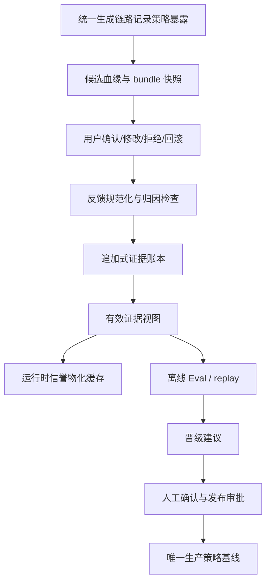

# PiNovelStudio 用户反馈证据管道开发计划

**任务编号**：USER-FEEDBACK-EVIDENCE-PIPELINE-1  
**版本**：v1.0  
**日期**：2026-08-12  
**状态**：真实闭环已验证（2026-08-12）——xinmo ch22 完成 generate→trace complete lineage→public feedback→ledger→policy；focused coverage≥80%；全量普通测试全绿。严格 active_prod 指纹路径仍需 recapture/promote；历史 evidence artifact 无可迁移记录  
**适用范围**：统一生产主链路中的策略暴露、用户反馈、策略学习与生产晋级治理

## 1. 正式结论

用户反馈不得直接充当奖励函数。它必须进入一条可归因、可撤销、可审计、分层晋级的证据管道：

```text
策略暴露 → 候选/策略血缘 → 用户操作 → 归因与污染检查
        → 追加式证据账本 → 可重建运行时信誉
        → 离线 Eval / replay → 人工复核 → 生产晋级审批
```

用户反馈可以影响后续请求中的策略选择概率，但不能越权修改当前正文、作品事实、CreativeConstitution、NarrativeState、FactGuard、Prompt Bundle、模型路由或章节最终提交状态。

## 2. 开发目标

本任务完成后，系统应满足：

1. 用户显式选择、修改、拒绝等行为被记录为可追溯事件，而不是直接转成奖励。
2. 无法明确归因的反馈默认 `neutral`，不污染文学策略信誉。
3. 多个策略共同作用时优先学习 `strategyBundle`；未经过消融实验或随机分流，不拆分为单策略因果。
4. 证据账本是唯一真相源；`strategy-policy.json` 只是可重建的运行时物化结果。
5. 撤销按 `evidenceId` 定点执行，并能从完整账本重算出与增量更新一致的信誉。
6. 在线 Thompson Sampling 只改变同一 `modelVersion` 下的策略选择概率，不改变生产契约和事实安全边界。
7. `candidate → active → 生产基线` 必须经过 Eval、replay、人工复核和审批，用户反馈不能单独晋级或退役策略。
8. 反馈写入失败不得回滚已确认正文，也不得污染已提交章节状态。

## 3. 当前基础与主要缺口

### 3.1 已有基础

以下模块已经提供可复用骨架：

- `v2/learning/user-feedback-ingestor.ts`
- `v2/learning/strategy-policy-store.ts`
- `v2/learning/user-modification-delta.ts`
- `v2/learning/strategy-outcome-recorder.ts`
- `v2/governance/chapter-proxy-approval-feedback-recorder.ts`
- `v2/governance/chapter-proxy-approval-feedback-ingestor.ts`
- `v2/core/strategy-evidence-dataset.ts`
- `v2/core/strategy-evidence-store.ts`
- `v2/learning/contextual-strategy-selector.ts`
- `v2/learning/model-version-migration.ts`

现有能力包括模型版本隔离、Beta/Thompson Sampling、candidate 准入隔离、证据撤销/污染/隔离、代理审批去重和离线准入建议。

### 3.2 必须优先修正的偏差

| 当前偏差 | 风险 | 计划修正 |
|---|---|---|
| `recordOutcome` 立即改变 `alpha/beta` | 运行时缓存可能与证据历史漂移 | 账本真相源 + 从有效证据重算物化信誉 |
| `revertLastOutcome` 只撤销最后一条 | 无法处理乱序、延迟反馈和旧章节回滚 | `evidenceId` 定点撤销，追加撤销事件后重算 |
| 用户修改默认就是 `loss` | 把事实修正、补充设定、局部润色误判为策略失败 | 引入 `feedbackLevel / editType / editScope / attributionConfidence` |
| 重度修改权重被当成多个样本 | 虚增样本量，扭曲胜率 | 分离 `decisionCount` 与 `weightedEvidence` |
| 单一 `strategyId` 记录候选结果 | 多策略协作时伪造单策略因果 | 记录 `strategyBundleId`，默认 bundle 级学习 |
| 证据字段缺少完整候选血缘 | 无法证明用户看到了什么、为何做出决定 | 补齐 run/candidate/prompt/exposure/source 等字段 |
| 文学反馈可自动 dormant/retired | 偏好变化、上下文变化或错误归因会误退役 | 在线只降采样/暂停探索；退役必须离线复核和人工确认 |
| 代理反馈记录缺少策略链 | `proxy_confirmed` 可能被过度当作强证据 | 代理反馈只有血缘完整且绑定有效时才可入账 |
| 运行时信誉与离线数据集职责重叠 | 数据集声称不改生产，但 recorder 仍直接改信誉 | 统一为 ledger → materialized policy → promotion 三层 |

## 4. 目标架构与不变量



必须长期保持以下不变量：

- 同一 `approvalId`、`orchestratorRunId`、`candidateId`、`feedbackEventId` 幂等；
- 同一用户、章节、工作区的反馈量受上限约束；
- 新 `modelVersion` 从弱先验开始，禁止继承旧版本胜率；
- `revoked`、`quarantined`、`polluted` 证据不得参与晋级或运行时信誉；
- 反馈只影响下一次请求；当前请求、当前正文和已提交状态不可被异步反馈改写；
- 事实安全事故可以即时熔断，单纯文学负反馈只能观察、降权或进入离线复核；
- 生产只有一套策略基线，不维护可执行的新旧并行版本。

## 5. 规范化数据契约

### 5.1 候选血缘快照

统一生成或编辑阶段在 trace 中记录不可变的 `StrategyExposure`：

```ts
interface StrategyExposure {
  exposureId: string;
  orchestratorRunId: string;
  sourceChapter: string;
  modelVersion: string;
  promptBundleId: string;
  candidateId: string;
  deliveredSource: "editorial" | "raw" | "fallback";
  strategyBundleId: string;
  strategyIds: string[];
  createdAt: string;
}
```

反馈证据至少关联：

```text
orchestratorRunId
candidateId
strategyBundleId
strategyId（仅在单策略因果成立时填写）
modelVersion
promptBundleId
deliveredSource
exposureId
feedbackEventId
sourceChapter
```

### 5.2 反馈等级

| 等级 | 含义 | 默认策略信誉行为 |
|---|---|---|
| `explicit_direct` | 用户明确选择候选，候选和策略血缘完整 | 强证据 |
| `explicit_edit` | 用户修改候选，修改类型、范围和原因可归因 | 强证据 |
| `proxy_confirmed` | 代理审批稿被接受，血缘完整且无冲突 | 中强证据 |
| `implicit_accept` | 用户未修改即接受 | 记录但通常不更新 |
| `natural_language_unattributed` | “还行”“不对”等无法定位原因 | 只记录，`neutral` |
| `mechanical_signal` | 扫描器、结构指标、自动评分 | 不更新文学信誉 |
| `conflicted_or_revoked` | 冲突、后续回滚、污染或撤销 | 隔离/撤销 |

### 5.3 用户修改分类

`editDistance` 只描述幅度，不直接决定输赢。至少拆分：

- `editScope`：`token` / `sentence` / `paragraph` / `scene` / `chapter`
- `editType`：`typo` / `language` / `voice` / `motivation` / `structure` / `fact` / `setting_completion` / `plot_direction`
- `attributionConfidence`：`high` / `medium` / `low` / `none`
- `decisionCount`：真实独立用户决策数，单次修改恒为 1
- `weightedEvidence`：用于置信度统计的加权量，不等于样本数

默认解释：局部错别字和句式润色为 `neutral` 或弱 `loss`；人物声音、动机、事件顺序和冲突结构重写为强 `loss`；事实、时间线、世界观修正记为 FactGuard/上下文问题，不直接惩罚文学策略；修改 raw 或非该策略候选不计入该策略信誉。

### 5.4 证据账本

证据存储采用追加式事件模型。原始观察永不改写，撤销、污染、隔离和冲突解决均追加新事件，并通过 `evidenceId` 关联：

```text
observation
revoke(evidenceId)
quarantine(evidenceId)
pollute(evidenceId)
resolve_conflict(evidenceId, resolution)
```

有效证据视图由完整账本确定性计算，不依赖“最近一条”或文件截断后的局部状态。现有 schema 需要一次性升级并完成历史迁移/隔离；不得长期维护 v1/v2 两套运行时协议。

## 6. 分阶段开发任务

### Phase 0：契约冻结与安全基线（P0）

**目标**：先锁定不可越权边界和新数据契约，阻止继续扩大错误学习。

**任务**：

1. 新增反馈等级、归因、修改分类、bundle、exposure、幂等键和反馈上限的类型定义。
2. 明确 `feedback → next request only` 的时序约束。
3. 在公共入口和内部调用点禁止反馈直接修改正文、事实状态、Prompt Bundle、硬门禁和生产路由。
4. 将当前文学反馈触发 `retired` 的路径改为“生成观察/降采样建议”，事实安全事故保留即时熔断。

**重点文件**：`v2/core/types.ts`、`v2/learning/strategy-outcome-recorder.ts`、`v2/learning/strategy-policy-store.ts`、`v2/core/unified-orchestrator.ts`。

**RED/GREEN**：先新增越权和时序失败测试；再以最小改动让测试通过。

**退出条件**：任何单次反馈都不能改变当前请求、当前章节或生产硬约束；相关 focused tests 全部通过。

### Phase 1：候选血缘与反馈接线（P0）

**目标**：每条反馈都能回答“用户看到了哪个候选、由哪些策略共同产生、来自哪次运行”。

**任务**：

1. 在统一生成、作者风格优化、代理审批和定稿路径生成并持久化 `StrategyExposure`。
2. 扩展 `chapter-proxy-approval-feedback-recorder.ts` 和 ingestor，透传 `runId/candidateId/strategyBundleId/exposureId/modelVersion/promptBundleId`。
3. 对缺少完整血缘的代理反馈标记为 `natural_language_unattributed` 或 `quarantined`，不得按 `proxy_confirmed` 强更新。
4. 增加 approval/run/candidate/feedback 四类幂等键，重复摄入返回原结果而不是新增 evidence。

**重点文件**：`v2/governance/chapter-proxy-approval-feedback-recorder.ts`、`chapter-proxy-approval-feedback-ingestor.ts`、`v2/core/unified-entry.ts`、`v2/core/unified-orchestrator.ts`、`handlers/public-handlers.ts`。

**退出条件**：同一反馈重复提交不增加 decision/evidence；每条可学习反馈均可回溯至 exposure 和候选。

### Phase 2：反馈归因与修改语义（P0）

**目标**：把“用户修改”从简单 loss 改为可解释的分层证据。

**任务**：

1. 扩展 `user-modification-delta.ts`，输出 `editScope/editType/attributionConfidence/factIssue/settingCompletion/retainedCoreEffect`。
2. 改写 `user-feedback-ingestor.ts`：实现七级反馈语义，无法归因默认为 `neutral`。
3. 删除“raw 交付稿也记该策略 loss”的逻辑；raw 或非策略候选不计入该策略信誉。
4. 保留重度修改权重，但新增 `decisionCount`，保证一次重度修改只算一个决策。
5. 事实修正、补设定、剧情方向变更进入上下文/FactGuard 类别，不直接惩罚文学策略。

**退出条件**：16 项最小 Eval 中的 1–7、13 全部通过；未归因反馈污染率为 0。

### Phase 3：Bundle 优先的结果记录（P0）

**目标**：多策略共同作用时不伪造单策略因果。

**任务**：

1. 扩展 `strategy-outcome-recorder.ts`，支持 `strategyBundleId` 和 `strategyIds`。
2. 当 bundle 内策略数大于 1 时，默认只写 bundle 级 evidence；单策略 evidence 只有在消融实验、随机分流或明确单策略暴露时才允许写入。
3. `ContextualStrategySelector` 返回选择快照和 bundle 标识，trace 记录实际暴露而非仅记录采样结果。
4. bundle 信誉和单策略信誉分区存储，禁止从 bundle 结果反推单策略胜负。

**退出条件**：多策略共同改变正文时，所有接受/拒绝结果都能正确归因到 bundle；无未经授权的单策略拆分。

### Phase 4：证据账本与可重建信誉（P0）

**目标**：将 evidence ledger 设为真相源，运行时信誉变为可重建缓存。

**任务**：

1. 升级 `strategy-evidence-dataset.ts` 与 `strategy-evidence-store.ts` 的 canonical schema，补齐 lineage、feedback level、attribution、decisionCount 和 bundle 字段。
2. 实现追加式 revoke/quarantine/pollute/conflict-resolution 事件。
3. 新增 `recomputeStrategyReputation(ledger, modelVersion, scope)` 纯函数，确定性计算 `alpha/beta/sampleCount/consecutiveLosses`。
4. `StrategyPolicyStore` 改为物化层：支持从完整 ledger 重建、校验增量更新与重算结果一致；移除对 `revertLastOutcome` 的依赖。
5. 处理历史 evidence：一次性迁移可识别字段；无法补齐血缘的记录进入 quarantine，不得静默补全。

**重点文件**：`v2/core/strategy-evidence-dataset.ts`、`strategy-evidence-store.ts`、`v2/learning/strategy-policy-store.ts`。

**退出条件**：撤销乱序、延迟反馈、旧章节回滚和重复摄入后，重算结果与增量结果 100% 一致；历史记录不可被物理删除或覆盖。

### Phase 5：在线 Thompson Sampling 安全边界（P1）

**目标**：在线学习只改变后续策略采样，不越权改变生产契约。

**任务**：

1. selector 只消费当前 `modelVersion`、有效且已准入的 active reputation。
2. 新模型版本从弱先验起步，禁止复制旧模型 alpha/beta；保留版本迁移审计信息。
3. 单次反馈不得触发 active/生产基线切换；最多更新下一次请求的采样概率或暂停探索建议。
4. 文学负反馈不得自动 `retired`；`retired` 只能由离线复核 + 人工审批产生。
5. 增加章节、用户、工作区反馈上限和异常突发保护。

**重点文件**：`contextual-strategy-selector.ts`、`model-version-migration.ts`、`strategy-policy-store.ts`、治理 release 模块。

**退出条件**：16 项最小 Eval 中的 8–12、15–16 全部通过；单次反馈自动切换生产策略次数为 0。

### Phase 6：离线 Eval、晋级与人工审批（P1）

**目标**：运行时信誉、离线证据和生产晋级彻底分层。

**任务**：

1. 扩展 `strategy-evidence-dataset.ts` 的 partition summary，区分真实用户 verdict、代理 proxy、机械信号和人工复核。
2. `eligible decisions >= 5`、`human-equivalent verdicts >= 3` 仅作为工具门槛，不把 proxy 等同真实用户文学判断。
3. 增加多章节、多上下文 replay、消融/随机分流证据和回归 Eval。
4. 生成晋级建议包：样本数、决策数、归因置信度、bundle/单策略范围、污染/撤销统计、模型版本、人工复核记录。
5. 只有审批记录完成后，才允许 `candidate → active` 或更新唯一生产策略基线。

**退出条件**：没有 Eval/replay/人工复核/审批记录的策略不能进入生产；revoked/quarantined evidence 晋级率为 0。

### Phase 7：全矩阵验证与可观测性（P1）

**目标**：把证据管道的正确性变成自动化门禁。

**必须覆盖的 16 项场景**：

1. 完整绑定的 editorial 被接受；
2. editorial 被接受但缺少策略归因；
3. editorial 被轻度局部修改；
4. editorial 被重度结构修改；
5. 用户只修改事实；
6. 用户拒绝代理稿；
7. 用户 rollback 已提交章节；
8. 同一 `approvalId` 重复摄入；
9. 同一 run 重复产生 evidence；
10. 新模型不能继承旧模型信誉；
11. revoked evidence 不得参与晋级；
12. quarantined evidence 不得参与晋级；
13. 无法归因的自然语言反馈不得污染策略；
14. 反馈写入失败不能回滚已确认正文；
15. 单次反馈不能自动切换生产策略；
16. 反馈不能修改硬门禁、事实状态或 Prompt Bundle。

**建议测试文件**：

- `tests/user-feedback-attribution.test.mjs`
- `tests/strategy-bundle-lineage.test.mjs`
- `tests/strategy-evidence-ledger-recompute.test.mjs`
- `tests/feedback-idempotency-limits.test.mjs`
- `tests/feedback-rollback-transaction-boundary.test.mjs`
- `tests/strategy-promotion-governance.test.mjs`
- 更新现有 `phase6-online-learning.test.mjs`、`evolution-release-governance-g7-feedback-ingestor.test.mjs`、`strategy-evidence-*.test.mjs`

**验收指标**：

| 指标 | 目标 |
|---|---:|
| 重复摄入率 | 0 |
| 未归因反馈污染率 | 0 |
| 跨模型版本污染率 | 0 |
| revoked/quarantined 晋级率 | 0 |
| 用户反馈可回溯率 | 100% |
| 反馈系统失败导致正文事务失败 | 0 |
| 单次反馈触发生产策略切换 | 0 |
| evidence 重算与增量信誉一致率 | 100% |
| 关键模块测试覆盖率 | ≥80% |

### Phase 8：迁移、清理与文档收敛（P1）

**任务**：

1. 执行一次性历史账本迁移和无法归因记录隔离。
2. 物理删除或移出生产闭包的旧奖励语义、`revertLastOutcome` 依赖和直接 `recordOutcome` 学习路径；不保留可执行双基线。
3. 更新 `docs/project-memory.md`、顶层开发计划和相关治理文档中的当前事实。
4. 补充运行手册：如何查询 exposure、撤销 evidence、重算 reputation、发起晋级审批和处理冲突。
5. 完成 clean checkout 的 build、focused tests、全量 tests、replay 和依赖边界检查。

## 7. 执行依赖与并行安排

### 必须串行

```text
Phase 0 → Phase 1 → Phase 2/3 → Phase 4 → Phase 5 → Phase 6 → Phase 7 → Phase 8
```

原因是数据契约和账本语义未冻结前，不能并行修改 ingest、policy 和 promotion，否则会产生不可重放的证据格式。

### 可并行

Phase 2 完成类型契约后，可并行开展：

- 修改分类器与归因单元测试；
- proxy feedback 血缘接线；
- ledger schema 校验与持久化测试；
- promotion/replay 报告设计。

但合并前必须由同一套 canonical schema 和 outcome 语义收口。

## 8. 明确不做

- 不把用户反馈直接转成奖励函数或“多个独立样本”；
- 不根据一次拒绝自动重写当前章节或切换生产策略；
- 不允许文学反馈修改事实、世界观、硬门禁、Prompt 安全契约或章节提交状态；
- 不用机器扫描器、单 LLM judge 或 human-equivalent proxy 单独晋级文学策略；
- 不把 bundle 结果伪造为单策略结果；
- 不维护旧奖励路径与新证据路径两套可执行生产版本；
- 不在反馈链路中调用网络模型解释用户意图；无法归因就记录为 neutral/quarantine。

## 9. Definition of Done

只有同时满足以下条件，任务才可标记完成：

1. 所有反馈都有完整事件和候选血缘，或明确标记为不可归因；
2. 账本追加、撤销、隔离、冲突处理和重算均可回放；
3. 运行时信誉可以从账本完全重建，增量和重算一致；
4. bundle 优先归因已接入生产 trace；
5. 文学反馈不能越权修改当前正文、事实状态和生产契约；
6. 晋级路径包含 Eval、replay、人工复核和审批记录；
7. 16 项最小 Eval 和全量回归通过；
8. 指标达到第 7 阶段验收阈值；
9. 文档、schema、测试和生产依赖边界已收敛到唯一最新基线；
10. 未提交用户修改未被覆盖，clean checkout 可重新构建并验证。

## 10. 建议执行顺序

建议开发执行时按以下最小批次推进，每批次完成 TDD 的 RED → GREEN → 回归：

1. **批次 A**：Phase 0 + Phase 1，先冻结越权边界和完整血缘；
2. **批次 B**：Phase 2 + Phase 3，修正反馈语义并接入 bundle；
3. **批次 C**：Phase 4，完成 ledger 真相源和 reputation 重算；
4. **批次 D**：Phase 5 + Phase 6，收紧在线学习并建立晋级审批；
5. **批次 E**：Phase 7，跑完整 Eval/replay 和指标门禁；
6. **批次 F**：Phase 8，执行迁移、清理、文档收敛和最终验收。

